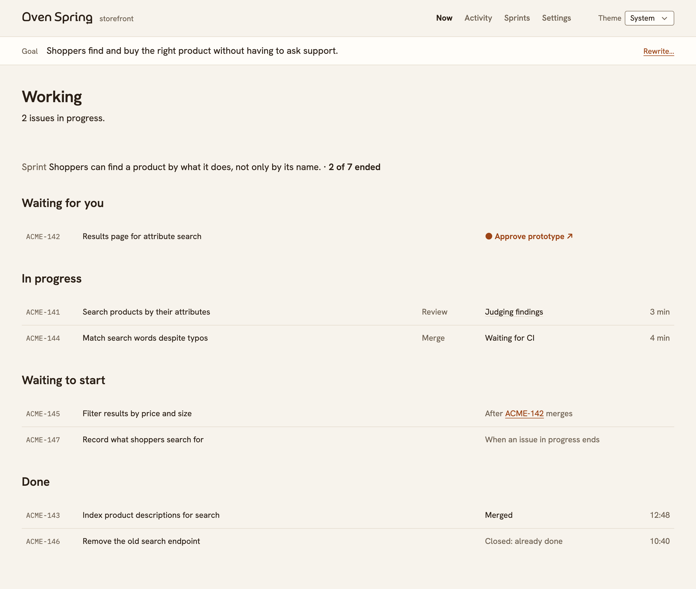
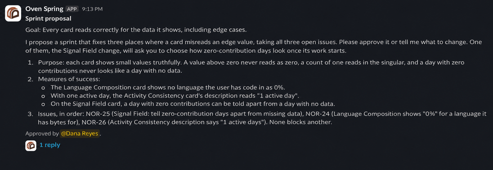
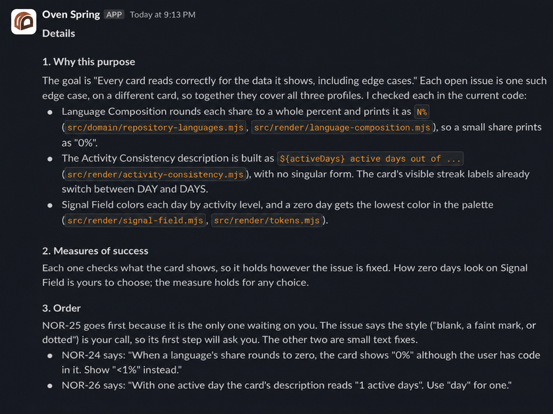

# Oven Spring

Oven Spring is a software factory that runs development in your repository. It plans each sprint from your product goal and the open issues in Linear or GitHub Issues, then carries each issue in the sprint through requirements, design, implementation, review, CI and merge with coding agents (Claude Code, Codex or OpenCode).

You set where the product is heading and answer, in Slack, the few decisions that need a person. Issues stay as their requesters wrote them. You don't write specs, split the work into tasks or assign it, and no one has to review a pull request before it merges.

<picture>
  <source media="(prefers-color-scheme: dark)" srcset="assets/now-dark.png">
  
</picture>

Oven Spring takes over the work that usually keeps a person in every loop:

| What a person usually does | What Oven Spring does instead |
|---|---|
| Decides what to work on next | The lead, the agent that plans the work and talks to you, proposes a sprint from the goal and the open issues |
| Turns an issue into a spec | The lead defines the outcome, the non-goals and each requirement with its source, and asks you only about behavior nothing in the repository decides |
| Checks the design | A reviewer checks it against the issue and the code before any code is written |
| Reviews the code | Separate code and security reviews, with each finding judged before anything changes |
| Confirms the behavior works | Your CI, through the base branch's required checks |
| Decides when to merge | A gate merges the exact commit that passed, and waits for your approval on the kinds of change you named |
| Steps in when something goes wrong | The lead looks for the cause, then retries, replans, drops the issue or asks you |
| Improves how the team works | Each sprint review revises the working agreements every agent reads |

Agents don't decide when their own work merges. The merge gate merges only the commit whose checks passed, with every approval GitHub requires in place. A change to the database schema, infrastructure, CI, external connections or contracts, or any other kind you name, also waits for your approval in Slack. The path rules you set and what the design declares sort changes into the first five. The kinds you name are judged by the design and code reviews. A guard stops the agents' commands that push, merge, approve, or match the commands you deny. [Safeguards](docs/GUIDE.md#safeguards) in the guide has the details.

The gate trusts the base branch's required checks and adds none of its own. If they include no end-to-end tests, a regression that no other check covers can merge. [Before you start](docs/GUIDE.md#before-you-start) lists what to prepare.

Oven Spring works with existing repositories. Your CI, branch rules, review bots and reviewers apply to the factory's pull requests as they do to anyone's. It is one executable, and it runs on your machine with the agent CLIs you already use.

## What you decide

The product goal is a few sentences on the dashboard, rewritten whenever priorities change. Every agent run receives it with the current sprint's purpose, and the lead plans each sprint from it.

Beyond the goal, these decisions reach you in Slack:

- the sprint the lead proposes, and its result at the end
- product behavior that nothing in the repository decides
- a design that adds an external connection or changes infrastructure, CI, the database schema, or a contract used outside the repository
- a prototype of a new screen
- the PRD of an issue that contains several independently valuable outcomes
- the merge of a change in a category you hold for yourself
- a recovery step that needs more than the agents are allowed to do

Only the work that depends on a decision waits for it.

## How a sprint runs

1. The lead proposes a sprint: one purpose, the issues it needs in dependency order, and the key results that will show whether the purpose was reached. You approve it in Slack, or reply and the lead revises it.
2. Issues run in parallel, each on its own branch and worktree, and each moves through Requirements, Design, Build, Review and Merge. A small change skips Design. A larger one is designed and reviewed before any code is written, and its design documents merge with the code in the same pull request.
3. When every issue has ended, you receive the sprint review in Slack. It judges each key result with its evidence and proposes changes to the working agreements and to the factory's knowledge, the notes about the codebase and its environment that the code itself doesn't show. You reply with what you think, or close the sprint, and the next proposal follows.

A sprint proposal as it reaches the owner in Slack:



Its thread gives the lead's reasons, down to the files it checked, and why the one issue that needs the owner's choice goes first:



## Why I built it

I wanted to hand the development process to agents. If people keep the design, they become the bottleneck. Agents that implement with no process around them leave code that gets harder to maintain with every change.

So Oven Spring runs the whole process, from requirements to merge, and fits into the way a team already works: its repository, its issues and its review rules. The product's direction stays with the people who own it.

## Requirements

- macOS or Linux, on arm64 or x86_64
- `git`, and a repository hosted on GitHub
- Linear or GitHub Issues
- A Slack workspace where you can create an app
- Claude Code, Codex or OpenCode, installed and signed in on the same machine
- Whatever the repository needs to build, test and run
- Checks the base branch requires, end-to-end tests among them ([Before you start](docs/GUIDE.md#before-you-start))

## Install

```sh
curl -fsSL https://github.com/shinpr/ovenspring/releases/latest/download/install.sh | sh
```

The script verifies the download against the release's checksums and puts `ovenspring` in `~/.local/bin`. Run it again to update. Each repository picks up the new version after `ovenspring stop` and `ovenspring start`, with nothing to change in the repository. The dashboard's header tells you when a newer release is out, and when one you installed still waits for that restart. It checks GitHub for new releases once a day.

## Start

From inside the repository:

```sh
ovenspring start
```

The dashboard opens in your browser on its setup page. There you connect GitHub, your issues and Slack, choose the agent CLI, let the lead find how the product runs, and write the goal. The first sprint proposal then arrives in Slack. [Setting up](docs/GUIDE.md#setting-up) in the guide goes through each step, the Slack app included.

After setup you work through Slack and the dashboard. The terminal is only for `ovenspring start`, which also reopens the dashboard when the factory is already running, and `ovenspring stop`.

## Cost

Agent usage is billed by your CLIs' providers, as it is when you use them yourself. The dashboard shows what every run cost at API prices, from the tokens it used, with totals for each issue and sprint. The measure is the same on every CLI and whatever plan you pay on, so you can weigh what a sprint delivered against what it took. [Choosing agents for each role](docs/GUIDE.md#choosing-agents-for-each-role) covers where a cheaper model fits.

## What it adds to your repository

- `.ovenspring/config.toml`, written by setup and edited from the dashboard's Settings
- the working agreements in `.ovenspring/agreements/` and the factory's knowledge (`.ovenspring/knowledge/` unless you choose another folder), which reach the base branch through the pull request each sprint review opens
- the design documents of the issues that needed them, merged with their code

Credentials, decisions, logs and the factory's state stay outside the repository.

## Documentation

- [Guide](docs/GUIDE.md): setup step by step, what reaches you in Slack, how merging works, safeguards, and configuration.
- The thinking behind the design: [Strict Boundaries, Free Path: How I Design a Software Factory](https://www.norsica.jp/blog/how-i-design-a-software-factory).

## License

MIT
