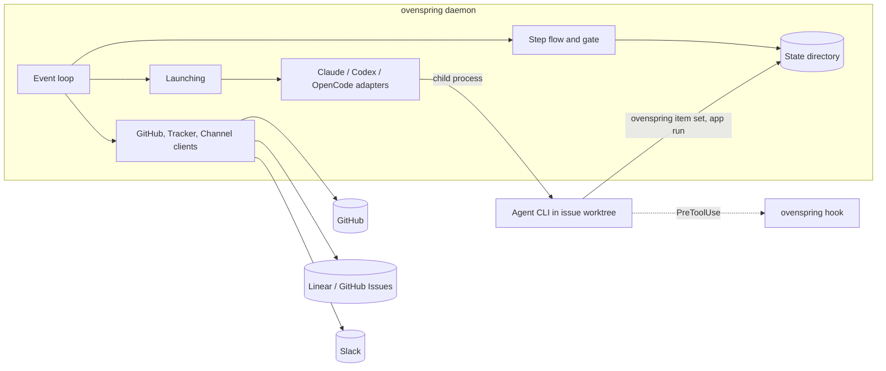

# Factory Core Design Document

## Overview

The factory core takes a sprint from proposal to review and each issue from its requester's words to a merged pull request. A daemon files one item per step on a board, launches one agent per item on the configured CLI, validates what the agent leaves, and moves the work to the next step by rules that need no judgment; agents make every judgment inside the boundaries and evidence each step owes. This document covers the daemon, the board, the step flow, agent launching, the factory's prompt set, worktrees and previews, the merge gate, guard hooks, exceptions, and the tracker and GitHub clients.

### Referenced UI Spec

- UI Spec path: `docs/ui-spec/oven-spring-ui-spec.md` (the core produces the states it shows; the owner-facing surfaces are designed in `docs/design/owner-interface-design.md`)

## Background and Context

### Prerequisite ADRs

- `docs/adr/ADR-0001-rust-single-binary.md`: the core is Rust in the single binary.
- `docs/adr/ADR-0003-binary-distribution.md`: prompts are assembled from the binary; the factory's skills are written into each worktree it creates, ignored by git.
- `docs/adr/ADR-0004-slack-socket-mode-channel.md`: the core talks to the owner only through the `Channel` trait.
- `docs/adr/ADR-0005-file-board-and-state-outside-repository.md`: items are Markdown files, outputs are validated JSON, logs are JSON Lines, all in the per-repository state directory.
- `docs/adr/ADR-0006-agent-launch-permissions-and-guard.md`: backend adapters, permission profiles, per-launch hooks, skills through each CLI's own loading.
- `docs/adr/ADR-0007-daemon-owns-external-writes.md`: only the daemon reads from and writes to the tracker, GitHub and Slack.

### External Resources Used

| Resource (project-tier label) | Feature-specific identifier | Notes |
|-------------------------------|-----------------------------|-------|
| Code host API | GitHub REST: pulls, check-runs, commit statuses, reviews, review comments, issue comments, collaborators permission, `rules/branches/{branch}` and classic branch protection, merge; GitHub GraphQL `reviewDecision` and `mergeStateStatus` | Read and write by the daemon only |
| Tracker API | Linear GraphQL (issues, comments, relations, workflow states); GitHub REST issues, comments, `dependencies/blocked_by` | Behind the `Tracker` trait |
| Agent CLIs | `claude`, `codex`, `opencode` non-interactive modes | Built per CLI in `crates/agents/src/backend.rs` |

### Requirement Convergence

- **Outcome**: N/A — covered by PRD `docs/prd/oven-spring-prd.md`
- **Non-Goals**: N/A — covered by PRD `docs/prd/oven-spring-prd.md`
- **Open questions**: None

### Standards and Assumptions

#### Applicable Standards

- [x] Rust 2024 edition, `cargo fmt`, `cargo clippy -D warnings` `[explicit]` - Source: this design (new repository)
- [x] Implementation and test rules of the factory's own development follow the dev-workflows-fullstack coding and testing skills `[explicit]` - Source: the owner
- [x] Prompts follow "be strict about boundaries and evidence, flexible about the path", and BP-001 to BP-009 `[explicit]` - Source: the owner; References

#### Assumed Behaviors

- [x] Codex applies `PreToolUse` hooks supplied for one launch through `-c hooks.PreToolUse=[...]` when the launch passes `--dangerously-bypass-hook-trust`; without that flag Codex skips them as hooks needing review - Evidence: probe P1 (2026-11-21, codex-cli 0.171.0): `git push` denied with the hook's reason in auto and bypass; https://developers.openai.com/codex/hooks (Review and trust hooks) - Design effect: the flag lets every enabled hook run without persisted trust for that launch, the user's own untrusted user-level hooks included; accepted, since the launch already excludes the user's plugins and connectors - Confirmed: Yes
- [x] Claude Code and Codex keep user-level skills, plugins, MCP servers and connectors out of a factory launch; OpenCode keeps out skills (by permission) and MCP servers (by configuration), not plugins - Evidence: OpenCode 1.18.20 (2026-11-25) loads the plugins of the global configuration and of its plugin folder under a launch's `OPENCODE_CONFIG_CONTENT`, an empty `plugin` list included, and has no switch for them; probe P2 (2026-11-21): Claude Code (`--setting-sources project,local`, `--strict-mcp-config`) lists only its built-in skills and no MCP server or connector; Codex lists no skill, connector, app or user MCP server once user skills are disabled by path, user MCP servers by name, and `features.apps`, `features.plugins`, `features.computer_use`, `features.browser_use`, `features.browser_use_external` and `features.image_generation` are false. Plugin-provided MCP servers (such as computer use) cannot be disabled by `mcp_servers.<name>` and need the feature flags - Design effect: Codex isolation uses the feature flags above and `notify=[]` - Confirmed: Yes
- [x] Each CLI loads the skills in the worktree as skills: Claude Code from `.claude/skills/` (project skills, kept by `--setting-sources project,local`), Codex from `.agents/skills/` between the working directory and the repository root, OpenCode from `.agents/skills/` and `.claude/skills/` - Evidence: Claude Code skills documentation (Choose where skills load); Codex skills documentation (Where Codex loads local skills); OpenCode skills documentation (Discovery) - Design effect: the factory writes its skills into both directories of each worktree; a repository skill the role does not select is switched off for the launch (Codex `skills.config` by path, Claude Code `skillOverrides` in the launch settings, OpenCode a `skill` permission denying its id) ; probe P2 (2026-11-21; Claude Code 2.1.330, Codex 0.171.0, OpenCode 1.18.20): each lists the factory's skills and the selected repository skill and neither unselected one, OpenCode also no user-level skill, and `git status` lists none of the factory's skills - Confirmed: Yes
- [x] Git ignores a directory that holds a `.gitignore` of `*`, that file included - Evidence: gitignore pattern rules; `assets` unit test `skills_written_into_a_worktree_are_loadable_and_never_committed` stages the worktree with `git add -A` and finds only the repository's own skill - Design effect: the factory's skills in a worktree never enter a commit, without touching the repository's own ignore files - Confirmed: Yes
- [x] Claude Code `-p` honors `--permission-mode auto` and runs `PreToolUse` hooks from a `--settings` file - Evidence: probe P1 (2026-11-21, Claude Code 2.1.330): `git push` denied by the hook in auto and bypass; a manual push from the same repository succeeded - Confirmed: Yes
- [x] Codex's auto-review answers approval requests in `codex exec` with `approval_policy = "on-request"` and `approvals_reviewer = "auto_review"`, with no person present - Evidence: probe (2026-11-21): a write outside the workspace was put to auto-review, approved, and the run completed without waiting - Confirmed: Yes
- [x] Hooks fire when a launch runs in `bypass` mode on Claude Code and Codex - Evidence: probe P1 (2026-11-21), both CLIs - Design effect: the bypass warning does not need to say the hooks are off - Confirmed: Yes
- [x] GitHub's merge endpoint refuses when `sha` differs from the pull request head - Evidence: GitHub REST "Merge a pull request" `sha` parameter - Design effect: the gate relies on it to merge only the checked commit - Confirmed: Yes

#### Quality Assurance Mechanisms

- [x] `cargo fmt --check`, `cargo clippy --all-targets -D warnings` — Enforces: format, lints — Config: `rustfmt.toml`, `Cargo.toml` `[lints]` — Covers: `crates/**` — Status: `adopted`
- [x] `cargo test` — Enforces: unit and integration tests — Covers: `crates/**` — Status: `adopted`
- [x] `cargo deny check` — Enforces: dependency licenses and advisories — Config: `deny.toml` — Covers: project-wide — Status: `adopted`
- [x] Prompt-set check — Enforces: every step file has an output type, with outputs it must accept and outputs it must refuse, and names skills that exist — Source: `cargo test -p ovenspring-agents` — Covers: `factory/**` — Status: `adopted`

### Problem to Solve

Carry issues from the tracker to merged pull requests with no person in the loop except for the decisions that are theirs, toward the product goal the owner sets, safely enough that nobody reviews code before merge.

### Current Challenges

None open.

### Requirements

#### Functional Requirements

PRD R4 to R8, R10, R11, AC-002 (the factory's skills), AC-014 and AC-057.

#### Non-Functional Requirements

- **Restart safety**: no work lost across a restart - Source: AC-039
- **Merge determinism**: only the exact checked commit merges - Source: AC-026
- **Responsiveness**: the daemon acts on a changed item within 5 seconds - Source: selected in Design Convergence because the requirements leave it unset; the owner's glance must not trail the factory

## Acceptance Criteria (AC) - EARS Format

### Sprint

- [x] **When** no sprint is running, a product goal is set, `[app]` is settled, the factory is not paused, the tracker has been read and a GitHub connection is configured, the system shall file a `sprint-plan` item for the lead with the goal and a snapshot of every open issue intake admits (AC-015, AC-060)
- [x] **When** a proposal holds no issue, the system shall start no sprint, post the lead's message to the owner as a notice with nothing to approve, and propose again once intake admits an open issue (AC-015)
- [x] **When** a `sprint-plan` item is done with a valid proposal, the system shall post the proposal through the channel and wait for the owner (AC-015)
- [x] **When** the owner approves a sprint proposal, the system shall start the sprint and file `requirements` for every proposed issue whose dependencies are met, up to the configured number of issues at once (AC-016)
- [x] **If** the owner replies to a proposal without approving, **then** the system shall file a `sprint-plan` item that names the reply (AC-017)
- [x] **When** every issue of the sprint is merged, held or dropped, the system shall file `facts` for the analyzer, then `sprint-review` for the lead, then `agreements-check` for the reviewer when agreements or knowledge change, and post the review; once the owner closes the sprint, the agreements and the knowledge files (under `[knowledge] path`, `.ovenspring/knowledge` by default) go to the base branch in one pull request (AC-041, AC-070)
- [x] **When** the owner closes a sprint whose review changes working agreements or knowledge, the system shall push them as a pull request that follows the merge setting (merged by the factory under `factory`, by the owner under `owner`), and shall file the next sprint's `sprint-plan` only once GitHub reports that pull request merged (AC-027, AC-042)
- [x] Every launch's prompt shall contain the product goal and, during a sprint, the sprint's purpose (AC-057)

### Issue

- [x] **When** a `requirements` output decides `close`, the system shall comment the evidence on the tracker issue, close it, and mark the issue dropped in the sprint (AC-018)
- [x] **When** a `requirements` output proceeds, the system shall run the steps of its scale: small to `implement` with the direct scope (through codebase analysis and the scope check first when the Small evidence gate is unresolved); medium through codebase analysis, the scope check, design, design review and cross-document consistency checking, test design, work plan and its review, and task decomposition; large through a PRD, its review and the owner's PRD approval first; a small or medium change whose `prdUpdate` names an existing PRD it alters updates that PRD, with its review and the owner's approval, before its own route (AC-018, AC-019, AC-061)
- [x] **If** a `requirements` or `scope-check` output, or a document step's (`prd`, `ui-spec`, `adr`, `design`, `work-plan`), carries a question for the owner, **then** the system shall post it and hold only that issue until the answer, which it passes to the step that asked (AC-025, AC-030)
- [x] **While** an issue is in its design phase (before `test-design`, `work-plan` or a small issue's `implement` has run), the system shall run each lead launch except `exception` in two turns of one session: a preparation turn (`turn: prepare`) whose output `{message, question}` is posted to the owner (as a question that holds the issue until the answer, or as a notice that does not), then the work turn, which resumes the preparation's session (`resume: <session>`); a work turn whose output asks the owner resumes its own session after the answer. A resumed launch that ends with an error its CLI did not record starts over in a new session, the answers among its refs.
- [x] **When** a design passes review and declares an approval category, the system shall request the owner's design approval before `plan` (AC-029)
- [x] **When** the scope check finds a UI Spec applies, the system shall file `prototype`, request the owner's prototype approval, then file `ui-analysis`, `ui-spec` and its review before `design` (AC-029)
- [x] **When** `decompose` is done, the system shall file one `implement` item per task file in dependency order, then `quality` once after the last task, and commit only after `quality` passes (AC-020)
- [x] **When** implementation is committed, the system shall file `code-review` for each review unit and one `security-review` at once, as separate launches running in parallel, whatever the issue's scale (AC-021)
- [x] **If** any review of a round finds anything, **then** once every review of the round has ended the system shall file one `review-response` for the executor with all their findings verbatim, which judges each; run `quality` after the executor completes the applied corrections in code, tests or product documents, recheck with the reviews that own an applied finding, and rerun a passed review only when `rerun-check` names it; when the executor applies none, the round converges (AC-021)
- [x] **When** reviews pass, the system shall bring the branch's current head and the base into the worktree, push the issue branch and open or update its pull request, writing its body again so it links, in Slack, each answered exchange with the owner that no document records (the lead's questions from `exception`, recoveries, stops); **if** bringing them in conflicts, **then** it shall file `merge-base` for the executor instead (AC-026)
- [x] **If** a check fails on the pushed commit, **then** the system shall file `fix-ci` for the executor (AC-036)
- [x] **If** the owner has set `limits.review_rounds` or `limits.fix_ci_rounds` and an issue's rounds reach it, **then** the system shall file `exception` for the lead instead of another round (AC-036)
- [x] Each launch shall run in the configured permission mode, `auto` unless the owner set `bypass` (AC-058)
- [x] **When** the daemon finds an issue in a non-waiting state missing an item its state calls for, it shall file that item (AC-039)
- [x] **When** checks pass and `review.bots` names a bot, the system shall wait until each review bot whose review it can observe has finished on the pushed commit, and file `review-response` for the executor, which judges each new comment from configured bots or write-access accounts as a finding (AC-022)
- [x] Comments from other accounts shall not be passed to any agent (AC-023)
- [x] **When** `review-response` applies comment findings, the system shall run `quality`, commit, push, reply in each comment's thread, and request a new review from each reviewer who requested changes (AC-022, AC-024)
- [x] **While** required approving reviews are missing, the system shall hold the issue in `waiting-review` and keep other issues running (AC-024)
- [x] **When** the merge setting is `factory`, the system shall merge only the head commit whose required checks passed, when the branch contains the base head, every required approval is present and every owner approval for that commit is recorded (AC-026, AC-028)
- [x] The gate shall judge the pull request's current head, whoever pushed it; **if** the base moved after checks, **then** the system shall return the issue to push, which brings the base in (AC-026)
- [x] **When** a pull request changes `.ovenspring/`, the agreements or knowledge folder, or the repository's agent instructions file (`AGENTS.md`, `CLAUDE.md`), the system shall hold it for the owner whatever its design declared; the agreements pull request passes the same gate as an issue's, its `factory-configuration` hold met by the owner's closing of the sprint review rather than a request per commit; under `owner` the factory waits for the merge without posting M-06 (AC-014, AC-042)
- [x] **When** the merge setting is `owner` and the gate's conditions other than owner approvals hold, the system shall notify the owner that the pull request is ready and mark the issue merged once GitHub reports it merged (AC-027)

### Launching and guard

- [x] Each launch shall run on the role's configured CLI, model and effort with the same rules, role and step files (AC-007, AC-051)
- [x] Each launch's prompt shall end with the role's additional instructions when set (AC-009)
- [x] Each launch shall have the factory's skills and the role's selected repository skills available as skills through its CLI, and no other repository skill (AC-008); the factory's skills shall never enter a commit (AC-002)
- [x] **When** an agent on Claude Code or Codex runs `git commit`, `git push`, a merge, an approval, or a command the owner denied, the hook shall deny it; the factory commits and pushes itself (AC-054)
- [x] **If** a launch fails because its provider is overloaded (the error kind its CLI recorded), **then** the system shall retry it after five minutes up to three times, and otherwise pause and post M-08 naming the issue, the step and the CLI's message (AC-037)
- [x] **When** the daemon starts, items left `doing` shall run again (AC-039)

### Observation, exceptions and recovery

- [x] On every GitHub poll, for each issue with a pull request in any state and for the agreements pull request, the system shall read the pull request: merged → the merged path; closed without merging → `exception`; otherwise the state's own wait, judged on the current head (AC-063)
- [x] **When** the daemon is about to work on an issue branch that has a pull request (an agent step, a push), it shall first bring the branch's current head into the worktree, so commits a person pushed are carried along; what the factory takes in from others is neither checked nor reviewed by the factory (AC-063)
- [x] **If** the same daemon operation (a launch, a commit, a push, a git command, a call the service answered with a client error) fails for the same issue or sprint on two passes in a row, **then** the system shall record the issue or sprint as stopped on that operation, keep its state, and file `exception` for the lead with the operation and its error; failures to reach a service (no connection, 5xx, rate limit) are retried without stopping and shown as the service unreachable since their first failure (AC-062)
- [x] **If** the agreements pull request's checks fail, **then** the system shall file `exception` for the lead on the sprint (AC-062)
- [x] **If** `exception` cannot run or ends blocked, **then** the system shall post the stop to the owner (M-02 for a question, M-09 with Resolved, and Cancel issue for an issue, when the lead could not be launched) (AC-062)
- [x] **When** an `exception` output is `recover`, the system shall copy its procedure to the isolated directory and post M-09 with the procedure as copied (AC-064)
- [x] **When** an owner approves M-09, the system shall run the copied procedure and nothing else; on success, or when an owner presses Resolved, it shall clear the stop, read the current state and run the stopped operation again; on failure it shall file `exception` with the procedure's output; a reply shall file `exception` with the reply (AC-064)
- [x] **When** the daemon starts, each stopped issue or sprint shall run its stopped operation again (AC-039, AC-062)
- [x] An error for one issue or the sprint shall not keep the daemon's pass from handling the others (AC-062)
- [x] The hook shall deny every tool call of a Claude Code or Codex launch whose input names the isolated directory or the credentials file (AC-064)

## Existing Codebase Analysis

### Implementation Path Mapping

| Type | Path | Description |
|------|------|-------------|
| Existing | `crates/core/` | Domain types, step flow, gate rules; no I/O |
| Existing | `crates/store/` | State directory, board, outputs, logs |
| Existing | `crates/agents/` | Prompt assembly, embedded factory assets, skills written into worktrees, backends, hook rules |
| Existing | `crates/integrations/` | GitHub, tracker adapters, Slack channel |
| Existing | `crates/daemon/` | Event loop, launching (`lib.rs`), worktrees and apps, outward actions |
| Existing | `crates/server/` | Dashboard HTTP API (owner-interface design) |
| Existing | `crates/cli/` | The `ovenspring` executable and subcommands |
| Existing | `factory/` | Rules, role files, step files, skills (embedded) |

### Integration Points

- **Integration Target**: agent CLIs; **Invocation Method**: child processes with the prompt on stdin, JSON event streams on stdout.
- **Integration Target**: GitHub and tracker; **Invocation Method**: HTTPS from the daemon.
- **Integration Target**: the repository; **Invocation Method**: `git` child processes (worktrees, commits read, push, fetch).

### Code Inspection Evidence

| File/Function | Relevance |
|---------------|-----------|
| `crates/core/src/flow.rs` `next`; `crates/core/src/sprint.rs` `next` | The issue's and the sprint's state machines |
| `crates/core/src/gate.rs` `decide`; `crates/daemon/src/pulls.rs` `checks_result`, `held_categories`, `gate_view` | The merge gate and what it reads |
| `crates/agents/src/backend.rs`, `prompt.rs`, `guard.rs`, `assets.rs` | Launch commands per CLI, prompts, the guard, skills written into worktrees |

### Fact Disposition Table

| Fact | Disposition |
|------|-------------|
| Skills reach agents as files written into each worktree, loaded by each CLI | Keep |
| Every reported check must finish and succeed, and every required one; with none reported, the gate waits the silent-bot interval (3 minutes) after the push | Keep |
| Changes to `.ovenspring/` at the repository root, the agreements and knowledge folders, and `AGENTS.md`/`CLAUDE.md` at any depth are held as `factory-configuration` | Keep (AC-014) |
| The agreements pull request goes through the gate and the same observation and failure handling as an issue's | Keep |
| Decisions, approvals, recoveries and cancel requests sit in an isolated directory no launch is given | Keep |
| The guard's rules catch honest mistakes; they do not follow `eval`, nested `sh -c` or wrappers | Keep |
| Output shapes are defined once, by the Rust types that validate them | Keep |

## Design

### Change Impact Map

```yaml
Change Target: factory core
Direct Impact:
  - crates/core, store, agents, integrations, daemon, cli
  - factory/ prompt set
  - issue worktrees: the factory's skills, ignored by git
Indirect Impact:
  - target repository: .ovenspring/config.toml, the `[agreements] path` and `[knowledge] path` folders, issue branches, pull requests
No Ripple Effect:
  - people's own agent sessions in the target repository (hooks and skills apply only to factory launches)
```

### Interface Change Matrix

None: no earlier version was released.

### Architecture Overview



One process per repository. The event loop runs every half second, well inside the 5-second responsiveness target, and reads the board, the channel's events and the timers on each pass.

### Data Flow

```
tracker poll ─▶ intake ─▶ sources/issues/<key>.md ─┐
goal.md, sprint.json ──────────────────────────────┼─▶ item (board/active/*.md) ─▶ prompt ─▶ agent
agreements (git show origin/<base>) ───────────────┘                                         │
                                                                                               ▼
                      events.jsonl ◀─ flow ◀─ validated outputs/<item>.json ◀─ item set done ─┘
                                         │
                                         └─▶ outward actions (push, PR, comment, post, merge)
```

### Integration Points List

| Integration Point | Location | Old Implementation | New Implementation | Switching Method | Verification Method |
|-------------------|----------|-------------------|-------------------|------------------|-------------------|
| Agent launch | `crates/daemon/src/lib.rs` | — | per-CLI commands in `agents::backend` | `roles.<role>.cli` | Fake-agent integration test; probes P1, P2 |
| Tracker | `integrations::tracker` | — | Linear, GitHub Issues | `tracker.kind` | Contract tests against recorded responses |
| Code host | `integrations::github` | — | GitHub REST and GraphQL | — | Contract tests; sandbox repository run |
| Owner channel | `integrations::channel` | — | Slack | — | Owner-interface design |

### Main Components

#### Store (`crates/store`)

- **Responsibility**: the per-repository state directory and every record in it.
- **Interface**: one `Store` over the per-repository directory: records (`write_record`, `read`), the board (file, read, set fields, archive), outputs (written at the path an item names and validated against the step's output type), the logs (`events.jsonl`, `launches.jsonl`), and the isolated directory (`write_isolated`, `isolated_names`).
- **Dependencies**: none beyond the file system.

Directory layout. The per-repository directory is `$XDG_STATE_HOME/ovenspring/repos/<name>-<hash>` on Linux (`~/.local/state` when unset) and `~/Library/Application Support/ovenspring/repos/<name>-<hash>` on macOS, `<hash>` from the canonical repository path; `$OVENSPRING_STATE_HOME` replaces the base when set. It holds two directories: `state/` (written `<state>` below), which every launch is given, and `isolated/` (`<isolated>`), which no launch is given and the hook denies (§ Guard rules). `<isolated>` holds what the factory trusts or runs on the owner's word:

```
isolated/
  dashboard.json            # the dashboard's address, kept so the next start serves on the same port
  decisions/<id>.json       # owner decisions requested and answered
  approvals/<id>.json       # recorded approvals
  recoveries/<id>.sh        # a recovery procedure as the owner is shown it
  recoveries/<id>.log       # what running it printed
  running-recoveries/<id>.json  # a procedure under way, until its result is taken in
  cancels/<key>.json        # the owner's cancel requests from the dashboard, until the daemon takes them
```

```
state/
  HALT                      # present while paused
  daemon.pid, daemon.lock, daemon.log
  goal.md                   # product goal text
  sprint.json               # current sprint; none while no sprint exists
  sprints/<id>.json         # ended sprints
  sprints/<id>-facts.md     # the analyzer's facts for a sprint's review
  issues/<key>.json         # per-issue state
  sources/issues/<key>.md   # tracker snapshot for agents
  sources/comments/<key>-<n>.md  # accepted PR comments, judged by review-response
  sources/answers/<id>.md   # the owner's answers and approvals, for the step that asked
  sources/recoveries/<id>.log
  sources/config.toml       # the configuration, for the facts step
  plans/<key>.md, plans/tasks/  # an issue's Work Plan and task files
  conversations/<thread>.json   # lead conversations started by a mention
  board/active/*.md
  board/archive/*.md
  outputs/<item>.json
  events.jsonl              # what the factory did; also the record of each error's start, repeats and clear, from which GitHub's and the tracker's reachability is derived (events-and-error-notices design)
  launches.jsonl
  launches/<item>.<n>.log   # CLI stdout/stderr of each launch
  launches/<item>.<n>/      # that launch's settings and guard rules
  product-run.json, told-waiting.json, prerequisites.json, mention.json, github-account.json
  worktrees/<key>/          # git worktree per issue, on branch ovenspring/<key>
  worktrees/base/           # detached checkout of origin/<base> for the lead's work outside an issue
  worktrees/agreements-<id>/  # the sprint's agreements and knowledge branch
  apps/<key>/               # per-worktree data and pid of the running app
```

#### Step flow (`crates/core::flow`)

- **Responsibility**: given the current records and one new fact (an item done, a decision answered, a check result, a poll result), compute the next actions. Pure function; the daemon executes the actions.
- **Interface**: `fn next(state: &IssueState, fact: &Fact, limits: Limits) -> (IssueState, Vec<Action>)` where `Action` is one of `File`, `Commit`, `StopApp`, `Push`, `AskOwner`, `RequestApproval`, `WaitForBots`, `AnswerComments`, `RunGate`, `NotifyReadyForOwner`, `CloseOnTracker`, `ClosePull`, `StartOnTracker`, `NotifyDependents`, `ReportStopped`, `RequestRecovery`; the sprint has its own `sprint::next(&SprintState, &SprintFact) -> (SprintState, Vec<SprintAction>)`.
- **Dependencies**: `crates/core` types only.

#### Phases

Every issue moves through five phases the owner reads: `requirements`, `design`, `build`, `review`, `merge`. Each step belongs to one (the step table's order: `requirements` to `prd-review` in requirements; `codebase-analysis` to `decompose` in design; `implement`, `test-review` and `quality` in build; the review round and `rerun-check` in review; pushing, CI, `fix-ci`, `merge-base`, the bots, required reviews and the gate in merge). A correction (an author run again in update mode, `review-response`, the `quality` after it) belongs to the phase of the check whose findings it answers, which the issue state names (`origin`, `check`); an `exception` keeps the phase it stopped in. `flow` computes the phase and the activity of an issue state, and the route of phases for a scale (Small: design skipped); the daemon records the phase on each launch's start line, so a launch keeps the phase it ran in. The dashboard reads these as codes (owner-interface design).

#### Gate (`crates/core::gate`)

- **Responsibility**: decide merge, return, or hold for one issue from observed facts.
- **Interface**: `fn decide(view: &View) -> Verdict` where `View { head_sha, checks_passed, contains_base, mergeable, reviews: Settled|ApprovalMissing|ChangesRequested, github_blocks, merge_by, held, owner_approved }` and `Verdict` is `Merge(sha)` or `Wait(Return(Push|Ci|Approvals) | HoldForOwner(categories) | ReadyForOwner | GitHubBlocks)`, decided in that order (§ Gate).
- **Dependencies**: none.

#### Launching and backends (`crates/agents::backend`, `crates/daemon/src/lib.rs`)

- **Responsibility**: turn an item into a running agent and its end into a fact. Each launch runs in its own process group, which ends with the agent: what the agent left running in the background stops when its launch ends (the issue's app runs in a group of its own and stays).
- **Interface**: `Launch { item, role, cli, model, effort, cwd, prompt, permissions, hook, env, … }`; free functions per CLI: `command(&Launch, &CodexUserConfig) -> CommandSpec`, `read_stream(cli, output) -> Outcome` (session, usage, cost, messages), `classify(…) -> Failure` with `Failure::{Transient(String), Fatal(String)}`; the daemon launches, waits and records in `crates/daemon/src/lib.rs`.
- **Dependencies**: store, prompt assembly.

#### Prompt assembly (`crates/agents::prompt`)

- **Responsibility**: build the exact text each launch receives.
- **Interface**: `fn assemble(ctx: &PromptContext) -> Result<String, PromptError>`.
- **Dependencies**: the embedded `factory/` files; agreements read with `git show origin/<base>:<agreements folder>/<file>`.

#### Worktrees and apps (`crates/daemon::worktree`)

- **Responsibility**: one worktree, branch, port and data directory per issue, holding the factory's skills; start the repository's app on demand.
- **Interface**: `ensure(issue) -> Worktree { path, branch, port, data_dir }`; `ovenspring app run -- <cmd>` (agents): starts the app with `app.start` unless the app's own process runs and `app.ready` answers, then runs the command with `PORT` and `OVENSPRING_DATA_DIR` set; the daemon starts and stops an issue's app for a preview requested from Slack. When something other than the app's own process answers on the issue's port, the app starts on a newly chosen port, so no other program's answer is taken for the app's. With `app.nothing_to_run`, `app run` runs the command alone and no preview is offered.
- **How the product runs is settled in setup** (AC-066). While `[app]` has neither `start` nor `nothing_to_run`, the daemon files one `run-commands` item for the lead in the base branch's worktree, and records it in `product-run.json`. The lead answers `{runs: commands|nothing|unknown, setup, start, ready, reason}`: commands that start the product on `$PORT` and keep its data under `$OVENSPRING_DATA_DIR`, or nothing to run, or that it cannot tell, each with the repository's evidence in `reason`. For commands, the daemon starts the product once in that worktree, on its own thread (setup, start, then the ready address within `READY_WAIT`), stops it, and records `{started: {port, seconds}}` or `{failed: {output}}`. What comes next is read from `product-run.json` on every pass, so a start the daemon was stopped during runs again when it starts, and a missing item is filed again. Nothing is written to `[app]` by the daemon: the owner keeps, changes or replaces the answer in setup, and the server writes `[app]` after starting changed commands the same way. A failed launch pauses the factory as any launch does; on resume the item runs again. No sprint begins while `[app]` is unsettled.
- **Dependencies**: git, configuration.

#### Hook (`crates/agents::hook`, `ovenspring hook`)

- **Responsibility**: deny guarded tool calls of factory launches.
- **Interface**: reads the CLI's hook JSON on stdin; writes the CLI's deny response with a reason; exit codes as each CLI defines.
- **Dependencies**: configuration (`guard.deny`).

#### GitHub and tracker clients (`crates/integrations`)

- **Responsibility**: the only access to these services (ADR-0007).
- **Interface**: `trait Tracker { open_issues(); comment(key, body); start(key); set_state(key, TrackerState) }`; `trait GitHub { viewer, pull_for_branch, pull, open_pull, branch_head, checks(sha), branch_rules(branch) (rulesets and classic protection, merged), reviews, standing (GraphQL `reviewDecision`, `mergeStateStatus`), comments, permission(login), reply, request_reviewers, merge(number, sha), delete_branch, close_pull, set_pull_body, git_remote }`; `viewer` returns the token account's login and numeric ID, and `git_remote` the `origin` URL the connection was built from and the token the client sends, for the daemon's Git commands ([GitHub account for factory Git operations](github-git-identity-design.md)).
- **Dependencies**: HTTPS client, credentials.

### Data Representation Decision

| Criterion | Assessment | Reason |
|-----------|-----------|--------|
| Semantic Fit | Yes | An item is one step for one launch, as the design article defines it |
| Responsibility Fit | Yes | The daemon owns routing; the agent owns the prose result |
| Lifecycle Fit | Yes | Active while the step runs, archived when its fact is consumed |
| Boundary/Interop Cost | Low | Plain files the agent reads with its own tools |

**Decision**: new — the board item, with machine-read results in validated JSON outputs.

### Selected Design

#### Items

```markdown
---
step: design-review
to: reviewer
status: open            # open | doing | done | blocked | failed
issue: ACME-142
sprint: 20261121-0905
round: 1
refs: docs/design/ACME-142.md, <state>/sources/issues/ACME-142.md
out: <state>/outputs/20261121-120400-design-review-ACME-142.json
unit:                   # a large change's code review unit; code-review only
---
Review the design of ACME-142.

## Result
<written by the agent>
```

The daemon writes everything above `## Result` (`turn: prepare` for a design-phase preparation turn, `resume: <session>` for a work turn that continues one), the request and the input entries the step's source agent declares (`field: value`, with `prior_feedback` and `correction_findings` written to files the entries name), and sets `open` and `doing`. The agent writes under `## Result`, writes its output JSON to `out`, and finishes with `ovenspring item set <item> status=done` (or `blocked`). `item set` accepts only `status` (`done`, `blocked`) and refuses `done` when `out` is missing or does not parse as the step's output type. Item names: `<YYYYMMDD-HHMMSS>-<step>-<issue>.md`, `<YYYYMMDD-HHMMSS>-<step>-sprint-<id>.md` for a sprint step, `<YYYYMMDD-HHMMSS>-run-commands.md`.

#### Steps

The issue pipeline is the implementation workflow of claude-code-workflows and codex-workflows (`recipe-implement` with `subagents-orchestration-guide`): each of their agents runs as its own launch, in their order, by the issue's Structural Scale. What the factory runs differently is limited to three things: the user's hearing and approvals become the owner's decisions in Slack (only what the rules reserve to the owner); the orchestrator's judgments are split: routing that the outputs fix goes to the daemon and judgment goes to a lead launch; the Work Plan and task files are written to the factory's state directory, not to the sources' `docs/plans/`: the sources keep them there only as uncommitted working state, which the state directory already is, so no commit or task change has to leave them out.

Each step receives what its source agent's input contract declares, as `field: value` entries the daemon extracts mechanically from the issue's records (the sources' Prompt Construction Rule); the review handoffs the sources define, `prior_feedback` for a recheck and `correction_findings` for a correction, carry the latest remaining question for each finding and the receiver's disposition where available. The previous judgment of the same review subject bounds every return, including returns through the lead, independently of the round counter. Each step's output is its source agent's result as the source defines it, unchanged; the daemon reads only the fields that route the flow (the "Routes on" column) and passes the rest, verbatim, to the steps that consume it. A source that returns a document path and no JSON (prd-creator, ui-spec-designer, work-planner, task-decomposer) uses technical-designer's result shape; a source that returns Markdown (design-sync) writes it under `## Result` and its summary block's fields to `out`. A step that is the orchestrator's judgment in the sources has no agent result to copy; its output holds the record the sources tell the orchestrator to keep. The factory adds a field only where the factory itself consumes it, and says which.

| Step | Role | Source | Output (`out`) | Routes on | Next (by the flow) |
|------|------|--------|----------------|-----------|--------------------|
| `requirements` | lead | requirement-analyzer, and the orchestrator's requirement convergence and Small evidence gate (subagents-orchestration-guide First Action Rule, Small Evidence Gate); the issue as written is the user's wording | requirement-analyzer's `{scopeEvidence, costEvidence}`, the `convergence` record (HC-01b), `structuralScale: small|medium|large|unresolved`; factory: `decision: proceed|close|ask`, `question` | `decision`, `structuralScale` | small: `implement`; unresolved or medium: `codebase-analysis`; large: `prd`; close; owner question |
| `prd` | lead | prd-creator (create; questions extracted when the issue and the owner's answers leave a section open) | technical-designer's result shape with `documentType: PRD`; factory: `question` | `status`, `question` | `prd-review`, or owner question |
| `prd-review` | reviewer | document-reviewer (`doc_type: PRD`) | document-reviewer's result | `verdict.decision`, `issues` | `prd` in update mode with the findings, or PRD approval (M-11) |
| `codebase-analysis` | lead | codebase-analyzer | codebase-analyzer's result | — | `scope-check` |
| `scope-check` | lead | the orchestrator after the first codebase-analyzer result: Small evidence gate when unresolved, requirement reopening, UI Spec applicability (documentation-criteria), ADR qualification (Choice then Durability filters); a qualifying decision the rules give the owner goes to the owner | `structuralScale`, `uiSpec: bool`, `adrDecisionPoints[]` with the owner's answers; factory: `decision: proceed|ask`, `question` | `decision`, `structuralScale`, `uiSpec`, `adrDecisionPoints` | small: `implement`; `prototype` when `uiSpec`; `adr` when decision points; else `design`; owner question |
| `prototype` | lead | ui-spec-designer's prototype input: one self-contained HTML page of the new screen in `docs/ui-spec/assets/<feature>/`, for the owner to approve | `{path, referenceStrength, basis}` (factory: M-04 links to it in the dashboard and states the strength) | — | prototype approval (M-04), then `ui-analysis` |
| `ui-analysis` | lead | ui-analyzer | ui-analyzer's result | — | `ui-spec` |
| `ui-spec` | lead | ui-spec-designer (`prototype_path` and `prototype_reference_strength` from the prototype's output) | technical-designer's result shape with `documentType: UISpec`; internal document, no approval | `status` | `ui-spec-review` |
| `ui-spec-review` | reviewer | document-reviewer (`doc_type: UISpec`) | document-reviewer's result | `verdict.decision`, `issues` | `ui-spec` in update mode with the findings, or `adr` / `design` |
| `adr` | lead | technical-designer's ADR batch part, for the decision points the owner answered; the ADRs are `Accepted` | technical-designer's ADR batch result | `status` | `adr-review` |
| `adr-review` | reviewer | document-reviewer (`doc_type: ADRBatch`); no owner approval: the owner already made the decision | document-reviewer's result | `verdict.decision`, `issues` | `adr` in update mode with the findings, or `design` |
| `design` | lead | technical-designer's Design Doc part, given the issue's UI Spec as `ui_spec` when it has one | technical-designer's result; factory: `approvals[]`, the held categories the change adds (AC-028) and the kinds of change a person reviews it falls under (`[person_reviews]`, listed in the design and code-review prompts; AC-069) | `status`, `approvals` | `design-review` |
| `design-review` | reviewer | document-reviewer (`doc_type: DesignDoc`) | document-reviewer's result | `verdict.decision`, `issues` | `design` in update mode with the findings, or `design-sync` |
| `design-sync` | reviewer | design-sync: the new or corrected Design Doc against every other Design Doc in the repository, so no earlier design is left contradicting it (it returns `SKIPPED` when there is none) | its `[SUMMARY]` fields and its conflicts as `findings` | `sync_status`, `findings` | `design` in update mode once if conflicts are found. After the author addresses them, or immediately if clear, commit and resume the implementation review round if one is pending. Otherwise request design approval (M-03) when required or proceed to `test-design` |
| `test-design` | executor | acceptance-test-generator | acceptance-test-generator's result | `status`, `generatedFiles` | `work-plan` |
| `work-plan` | lead | work-planner | technical-designer's result shape with `documentType: WorkPlan` | `status` | `plan-review` |
| `plan-review` | reviewer | document-reviewer (`doc_type: WorkPlan`) | document-reviewer's result | `verdict.decision`, `issues` | `work-plan` in update mode with the findings, or `decompose` |
| `decompose` | lead | task-decomposer | technical-designer's batch result shape: `{status, paths[]}` | `paths`; each task file's `Dependencies:` line | `implement` per task, in dependency order |
| `implement` | executor | task-executor (its skills' frontend references cover frontend work) | task-executor's result | `status`, `requiresTestReview` | `test-review` when `requiresTestReview`; next task; `quality` after the last |
| `test-review` | reviewer | integration-test-reviewer, given the files the task changed and choosing the integration and E2E tests among them by the repository's conventions | integration-test-reviewer's result | `status`, `qualityIssues` | `review-response` with the findings, or as after `implement` |
| `quality` | executor | quality-fixer, once after the last task (Lite Mode's Final Quality Run) and after every correction | quality-fixer's result | `status`, `incompleteImplementations` | `pass`, `verification_incomplete`: the daemon commits, then the review round; `stub_detected`: `implement` for each owning task with `incompleteImplementations` (after a round correction, in Review without `test-review`, and the round's rechecks follow `quality`) |
| `code-review` | reviewer | code-reviewer, one per review unit | code-reviewer's result; factory: `approvals[]`, the held categories and kinds a person reviews that the code shows | `verdict`, `approvals` | joins the review round; its `approvals` join the issue's held categories |
| `security-review` | reviewer | security-reviewer, once over the whole change | security-reviewer's result | `status` | joins the review round |
| `rerun-check` | lead | the re-run rule's evidence check (Post-Implementation Review Re-run rule), after a correction's `quality` | `{rerun: [{review, implementationFiles}]}` | `rerun` | the passed reviews it names, scoped to the diff |
| `review-response` | executor | task-executor with `correction_findings` (`test-review`'s, the round's, or the pull request comments), judging each with `reviewee-judgment` | task-executor's result; factory: `dispositions[]` `{id, review, disposition: apply|decline, reason}` | as `implement`, plus dispositions | an applied finding: round: `quality`, then the originating reviews with `prior_feedback`; `test-review`'s: `test-review` again with `prior_feedback`; comments: `test-review` when required, `quality`, then replies and push; none applied: the step after the check (round: push; comments: replies and the gate) |
| `fix-ci`, `merge-base` | executor | quality-fixer, on the failed checks and their logs, or on the conflict | quality-fixer's result | `status` | the daemon commits, then push |

The sprint steps (`sprint-plan`, `facts`, `sprint-review`, `agreements-check`, `conversation`) and `exception` are the factory's own, as is `run-commands` (§ Worktrees and apps). A step that ends `blocked`, or an executor or quality result that is `blocked` or `escalation_needed`, files `exception` (the sources' Specialist Result Acceptance); when `exception` itself ends blocked, the issue asks the owner. `exception` is also filed for a daemon operation that stopped an issue or the sprint, and for a pull request someone closed (§ Exceptions, recovery and resilience). Its item names what could not go on: the step and its result, or the operation and its error. Its actions: `retry` (the step or the operation runs again), `replan`, `redesign` and `drop` (issues only), `recover` with `procedure` (the script the factory is to run, whose first line names its interpreter) and `summary` (what happened, what the procedure changes, whether it can be undone), and `ask` with `question`. The lead chooses `recover` only when the way forward needs what agents may not do; anything an agent may do in the worktree, it does itself or through `retry`.

Medium and Large run every applicable row from `requirements`; Large adds `prd`, `prd-review` and the owner's PRD approval before `codebase-analysis`. Small runs `requirements`, then `codebase-analysis` and `scope-check` only when the Small evidence gate is unresolved, then one `implement` with the direct scope, `quality`, and the review round. Code and security reviews run for every issue: no person reviews the pull request.

**The review round.** After `quality` the daemon files every review of the round at once: `code-review` for each review unit and one `security-review`; they run in parallel. A Medium or Small change is one unit. A Large change is split as the sources split it (Post-Implementation Review Units): each task that no other task depends on forms a unit with every task it reaches through `Dependencies`; tasks that several units reach form one shared unit; a unit's `implementationFiles` are the files its tasks changed. At most three `code-review` launches of an issue run at once. When every review of the round has ended, the findings of all of them go verbatim to one `review-response`; one correction and one `quality` follow; then only the reviews that own an applied finding recheck, in parallel, with `prior_feedback`, and `rerun-check` names any passed review whose evidence the correction's diff invalidated. A passed review is not run again otherwise. When the executor applies nothing, the round converges.

A check's findings go verbatim to the step that receives them, which judges them itself: a document check's to the document's author run again in update mode; `test-review`'s, the round's and bot and write-access comments to the executor's `review-response`. The receiver applies `reviewee-judgment` first (no change, then removal or narrowing, then reuse, then a repair that names the result the smaller responses cannot deliver), declines optional additions, and writes a disposition for each finding in its own output; a handed finding left without one makes the item stuck, which files `exception`. A receiver that applies nothing ends the check (a document check cleared, the round converged, the comments answered and the gate run); one that applies something is rechecked except in design sync, which ends with the author’s dispositions. A finding that needs the owner reaches them through the receiver's own channel: a document step's `question`, or, after the design has passed, the item set `blocked` (or an executor's `escalation_needed`), which files `exception`. A maintained `decline` does not reopen the cycle; an `apply` maintained through two corrections files `exception`. Rounds have no other limit by default; an owner who wants one sets `limits.review_rounds` or `limits.fix_ci_rounds`, and reaching it files `exception`.

#### Commits

Agents do not commit. Every commit the factory creates, including the merges below and the agreements commit, is authored and committed as the configured GitHub token's account: its login as the name and `{id}+{login}@users.noreply.github.com` as the email. Every factory Git command that talks to `origin` (fetch, `ls-remote`, push) authenticates with the same token and never with the machine's credential helper or SSH identity ([GitHub account for factory Git operations](github-git-identity-design.md)). The daemon commits the worktree at fixed points, so every commit holds work that passed its check: a document (PRD, ADR, UI Spec, Design Doc) once its review passes; the implementation once `quality` passes after the last task; a correction once `quality` passes after it; a CI fix or a conflict resolution once `quality-fixer` passes. Before a push, and before an agent step on a branch that has a pull request, the daemon merges the branch's current head (`origin/<branch>`) into the worktree, and before a push also `origin/<base>`; these merge commits carry no code the factory wrote, and what they bring in is not checked or reviewed by the factory. A conflict aborts the merge and files `merge-base` for the executor, who resolves it within the issue's outcome. A `verification_incomplete` result is committed with the sources' `Verification-Limitation` and `Verification-Affected` trailers. The message is composed from the outputs that led to it (`changeSummary`, the document results). After each `implement` the daemon records the worktree's tree without committing (a temporary index and `git write-tree`), so each task's changed files are known for the review units. A rollback of uncommitted work by an agent is a destructive action that auto mode stops; in `bypass` the owner has accepted that risk.

What follows a commit waits for it (the `committing` state). When the repository refuses the commit (a hook, such as lint or knip, most often), or `origin` refuses the push for a reason other than the branch having moved (which the next push brings in), `quality` runs again with what the repository said as its correction finding, and the commit or push is made again once it passes; after two such runs in a row the lead takes it as an exception. A push that cannot reach `origin` is tried again on the next pass. Hooks are never skipped: only the daemon commits and pushes, and it passes no `--no-verify`; weakening a check instead of fixing what it reports is what the quality step's skills forbid (error suppression, bypassing safety mechanisms), and code review reads the whole change, the check configuration included.

#### Issue states

```yaml
State Definition:
  - Initial State: queued
  - Possible States: queued, requirements, asking, prd, prd-review, analysis, scope-check,
    prototyping, awaiting-approval, ui-analysis, ui-spec, ui-spec-review, adr, adr-review,
    designing, design-review, design-sync, test-design, planning, plan-review,
    decomposing, implementing, test-review, quality, reviewing {pending reviews, findings},
    responding, rerun-check, pushing, ci, fixing-ci, waiting-bots,
    committing, waiting-review, gate, held-for-owner, ready-for-owner, blocked-on-github, held,
    merged, dropped, exception, lead-asking (the lead asks the owner from `exception`),
    awaiting-recovery (the owner on the lead's recovery procedure), stopped (a stop the lead could
    not be launched to take, until the owner resolves it)

State Transitions:
  queued → dependencies merged → requirements
  requirements → small → implementing | unresolved, medium → analysis | large → prd | close → dropped | ask → asking
  prd → prd-review → PRD approval → analysis | small → implementing
  analysis → scope-check → small → implementing | large without an approved PRD → prd | ui spec → prototyping → prototype approval → ui-analysis → ui-spec → ui-spec-review
  scope-check | ui-spec-review → (owner-answered decision points) adr → adr-review → designing
  designing → design-review → design-sync → (approvals) awaiting-approval → test-design → planning → plan-review → decomposing → implementing(task 1..n)
  implementing → (test review) → next task | quality → commit → reviewing {code-review per unit, security-review}
  reviewing → each review ends → pending empty → findings → responding (executor) | none → pushing → ci
  document check → findings → responding (author) → design-sync or none applied → the step after the review | applied → the review again
  responding (executor, round) → applied → quality → (commit) → reviewing {owners of applied findings} (+ rerun-check when a passed review is retained) | none applied → pushing
  ci → failed → fixing-ci → commit → pushing
  ci → passed → waiting-bots → no comments → gate | comments → responding (executor) → none applied → gate | applied → quality → committing → pushing
  waiting-review → approvals present → gate
  gate → Merge → merged | Return → pushing | ci | waiting-review | HoldForOwner → held-for-owner → approval → gate | the owner holds → held → the sprint takes it up → gate
  gate → GitHub still blocks it → blocked-on-github → gate again on each poll
  gate (merge_by owner) → ready-for-owner → merged when GitHub reports it
  any → blocked/limit → exception → (lead's action)
  any with a pull request → merged on GitHub → merged | closed on GitHub → exception
  any not merged or dropped → the owner cancels (dashboard or Cancel issue in Slack, AC-067) → dropped
  dropped (by the lead or the owner) → its app stops, its pull request closes with its branch kept, the tracker records it canceled with the lead's note or the owner's words, and its queued dependents get exception
  pushing → brings in the branch head and the base → conflict → merge-base (executor) → commit → pushing
  any → the same daemon operation failed twice in a row → (state kept, stopped on it) → exception
  stopped → M-09 approved and the procedure succeeded, Resolved, retry, or a restart → the stopped operation again

System Invariants:
  - An issue's open or doing items are exactly those its state calls for: one step, or the pending reviews of its review round.
  - An issue merges only through gate with the sha the gate checked.
  - Every commit of code the factory wrote on an issue branch follows a passed review or quality check; its merge commits bring in the base or a person's commits and carry none of its own code.
  - Issues at once never exceed limits.issues_at_once.
  - Every state that waits on something outside the factory reads it on each poll, so a change made by a person moves the issue on.
  - A stopped issue is never retried silently: it has an `exception` open, or a pending M-02 or M-09.
```

Sprint states: `proposing → awaiting-approval → running → collecting (facts) → reviewing ⇄ checking-agreements → awaiting-review-approval → applying-agreements (only when the review changes agreements or knowledge) → ended`; `proposing → waiting-for-issues` on an empty proposal; any stage → `exception` or `asking` (a question, a recovery or a stop) when it cannot go on. No sprint record means no sprint; the next one begins as `proposing`. A proposal with no issue starts no sprint: the factory posts the lead's message on what is missing as a notice, waits until intake admits an open issue and proposes again. `applying-agreements` ends when the agreements pull request is merged, by the factory or by the owner as the merge setting says; a review without agreement or knowledge changes skips it. The next sprint waits for it because its launches read the agreements from the base. The agreements commit takes the configured GitHub account's identity, as every commit the factory makes (§ Commits); the agreements pull request is observed as an issue's is (§ Observation), and what no agent can fix in an agreements file (a failing check, a close, a conflict with the base) files `exception` on the sprint. The sprint's `exception` keeps the stage it stopped in and offers `retry`, `recover` and `ask`; its stops, recovery and Resolved work as an issue's. Closing the sprint (M-07's Close sprint) lets the review's agreement and knowledge changes merge and approves nothing else: the sprint moves to `applying-agreements`, or ends when nothing changed; the next starts from `proposing` like any sprint, with `sprint-plan`, which reads the ended sprint's review and the owner's replies to it, and the owner's approval of its proposal (M-07, M-01).

#### Prompt assembly

Each launch's prompt is, in order:

1. `factory/rules.md`: how to judge work (boundaries and evidence), who decides what (the owner's decisions and their sources), the roles' authority, the board contract (`item set`, outputs, `## Result`), the harm order of the repository's agent instructions file.
2. `factory/roles/<role>.md`, only for the steps without a source agent's definition (`requirements`, `scope-check`, `prototype`, `rerun-check`, `exception`, `run-commands`, `sprint-plan`, `sprint-review` and `conversation`: the lead's steps without a source agent). The only role file is `factory/roles/lead.md`. `facts` and `agreements-check` define their own work whole and take no role prompt. A step with one is its source agent's definition, which is the role it plays; a role prompt beside it would be a second, differing instruction for the same work. The role still selects the CLI, model, repository skills and working agreements of every step.
3. `factory/steps/<step>.md`: its source agent's definition, with its `Required skills` and `Preparation`; then one line naming the role's selected repository skills. Steps that play one source agent with the same text share its file (`review-response` reads `implement.md`; `fix-ci` and `merge-base` read `quality.md`), and what differs between them is in the item's request.
4. Working agreements: `common.md` and `<role>.md` from `origin/<base>:<[agreements] path>/`.
5. Context: the role; `turn: prepare` on a preparation turn; product goal; sprint purpose (not while proposing); the item's path; the worktree; the issue key; the working agreements folder (`[agreements] path` in the worktree) for facts, sprint-review and agreements-check, the steps that judge every agreement; the knowledge folder (`[knowledge] path` in the worktree); the current time.
6. For `design` and `code-review`, the kinds of change a person reviews (`[person_reviews]`), with their words.
7. The role's additional instructions under `# Additional instructions`, when set.

Skills' contents are not part of the prompt. Before each launch the factory writes its skills into the launch's working directory (the issue's worktree, or `worktrees/base` for the lead's work outside an issue) at `.agents/skills/ovenspring-<name>/` and `.claude/skills/ovenspring-<name>/`, each directory holding a `.gitignore` of `*` and named as its skill's `name`; files already current are left alone. Each CLI loads them, with the repository's own skills the role selects, through its own skill mechanism, and every other skill is switched off for the launch, the CLI's own included: Codex by path (`skills.config`, with the owner's skills and plugin skills), Claude Code by `disableBundledSkills` for its bundled skills and by name (`skillOverrides`) for the repository's others and `plugin-authoring`, which ships outside the bundled set, OpenCode by a `skill` permission that denies every skill but the factory's and the selected ones. Probe P2 checks each CLI in both permission modes. A role's selected skills must exist where its CLI loads them (`.claude/skills` for Claude Code, `.agents/skills` for Codex, either for OpenCode). The repository's own `AGENTS.md` (or `CLAUDE.md`) is loaded by the CLI from the worktree, as in people's sessions.

#### Factory skills (`factory/skills/`)

The issue pipeline's skills are claude-code-workflows' `dev-workflows-fullstack` skills as published, with codex-workflows' model-specific safeguards added where codex-workflows carries them (Codex reads and sizes skills before loading them; `reviewee-judgment` holds the stronger restraint codex-workflows puts on accepting findings). Each runs on Claude Code, Codex and OpenCode alike. Only what does not hold in the factory changes: the `name` (`ovenspring-` prefix), project-specific terms, and the parts of a workflow the factory runs differently, each stated where it changes. The skills of the sprint steps and `exception` are the factory's own.

| Skill | Source | Changed for the factory |
|-------|--------|-------------------------|
| `ovenspring-coding-principles` | ccw `coding-principles` (+ references) | name |
| `ovenspring-testing-principles` | ccw `testing-principles` (+ references) | name |
| `ovenspring-integration-e2e-testing` | ccw `integration-e2e-testing` (+ references) | name |
| `ovenspring-ai-development-guide` | ccw `ai-development-guide` (+ references) | name |
| `ovenspring-implementation-approach` | ccw `implementation-approach` | name |
| `ovenspring-requirement-convergence` | ccw `requirement-convergence` (+ references) | name (the workflow owns the hearing: the step files make the issue the user's wording and the lead's question the hearing) |
| `ovenspring-documentation-criteria` | ccw `documentation-criteria` (+ templates) | name |
| `ovenspring-llm-friendly-context` | ccw `llm-friendly-context` | name |
| `ovenspring-external-resource-context` | ccw `external-resource-context` (+ references) | name (its capture already returns missing evidence to an autonomous caller) |
| `ovenspring-reviewee-judgment` | cxw `reviewee-judgment` (+ references) | name |
| `ovenspring-writing-for-agents` | the factory's own | — (sprint steps and `exception`) |
| `ovenspring-writing-for-the-owner` | the factory's own | — (every text that reaches the owner) |

Each step loads the skills its source agent preloads, named in a `Required skills` section ("Load and read each skill completely before acting on your item"). References follow claude-code-workflows' safeguards for agents that skip them: a reviewer, designer or analyzer reads its references in a `Preparation` list before its work, without conditions; an executor or fixer reads each at the step that uses it, with what it decides; the step's completion check names the references the result was judged against.

#### Rules and roles (`factory/rules.md`, `factory/roles/`)

The rules hold how the team works (change course before patching, the minimizing stance), the factory's goal, the owner's decisions and their sources, the roles' authority, the board's item contract and when to set `blocked`. `factory/roles/lead.md` holds the lead's criteria for its steps that have no source agent.

#### Steps (`factory/steps/`)

Each issue step is its source agent's definition (the table in Steps) in its words; what changes is what the factory runs differently: inputs are the item and the sources it names by path, a stop is `status=blocked` with its reason, the output is the step's JSON contract, prose goes under `## Result`, the daemon commits, and the user's stops become the owner's decisions the rules reserve. The sprint steps and `exception` are the factory's own.

#### Launch permission profiles

| CLI | Command shape |
|-----|---------------|
| Claude Code | `claude -p --model M --effort E --permission-mode auto --add-dir <state> --add-dir <git common dir> --settings <launch>/settings.json --setting-sources project,local --strict-mcp-config --mcp-config <launch>/mcp.json --output-format stream-json --verbose --session-id <uuid>` (`--resume <session>` on a work turn); prompt on stdin; `settings.json` holds the `PreToolUse` hook `ovenspring hook`. `bypass`: `--dangerously-skip-permissions` in place of `--permission-mode auto` |
| Codex | `codex exec -m M -c model_reasoning_effort=E -s workspace-write -c approval_policy=on-request -c approvals_reviewer=auto_review -c sandbox_workspace_write.network_access=true -c sandbox_workspace_write.writable_roots=[<state>, <git common dir>] --dangerously-bypass-hook-trust <user skills disabled by path, user MCP servers by name; features apps, plugins, computer_use, browser_use, browser_use_external, image_generation off; notify=[]> <hook> --json -C <worktree> -` (`codex exec resume <session>` on a work turn); output budgets raised and the budget instruction set, so long reads are not cut silently. `bypass`: `--dangerously-bypass-approvals-and-sandbox` in place of the sandbox and approval options |
| OpenCode | `opencode run --format json --model <provider/model[#effort]>` (`--standalone` on OpenCode 2, so the launch's permissions take effect; `--session <id>` on a work turn) with permissions in `OPENCODE_CONFIG_CONTENT` allowing edits and commands inside the worktree and denying the guard's commands and `guard.deny`, written as `permission` for OpenCode 1 and as `permissions` for OpenCode 2 or later (`opencode --version` before each launch); no hook |

Each launch receives exactly the MCP servers the owner allows, resolved by name from the repository's `.mcp.json`, then the owner's `~/.claude.json`, then the owner's Codex configuration (Claude Code: `--mcp-config` with `--strict-mcp-config`; Codex: the owner's other servers disabled and missing ones defined by `-c`, `${NAME}` environment values forwarded by name; OpenCode: the `mcp` section of its configuration). Every launch reaches two places outside its worktree: the state directory, which it reads, and the repository's git common directory (where a worktree's commits are stored) (both are needed once the repository and the state directory are not under the system's temporary directory). Codex's sandbox lets it write only the parts of the state directory agents write (`board/active`, `outputs`, `apps`, `sprints`, `plans`). No launch is given `<isolated>`, where the decisions, approvals and recovery procedures the factory trusts are kept. The permission mode is one setting: `auto` (default) or `bypass`. When auto mode refuses an action a step needs, the agent reports the refusal and sets the item `blocked`; the lead's `exception` decides whether another way exists or the owner must change the mode.

#### Guard rules (`ovenspring hook`)

Deny, with a reason the agent reads:

- `git push` and `git commit` in any form (the daemon commits at the fixed points and pushes). OpenCode, without a hook, gets these and the rules below that name a command as patterns in its permissions.
- `gh pr merge`, `gh pr review --approve`, `gh api` calls to merge, review or approval endpoints.
- Commands matching `guard.deny` patterns in the configuration (production access).
- Any tool call whose input names `<isolated>` or the repository's credentials file, by its path in any tool's input (a file tool's path, a search's path or pattern, a shell command's text). The launch's hook therefore matches every tool, not only the shell. No launch is given `<isolated>` (`--add-dir`, Codex's writable roots), so the hook is the rule that holds in `bypass` and for shell commands; OpenCode gets the same paths denied with the other rules, in each spelling the hook reads; its `external_directory` refuses every directory outside the worktree but the launch's reachable ones (the state directory, the git common directory), and the MCP servers its own configuration defines are switched off unless allowed.

A rule matches each command of a command line after it is split at `;`, `&&`, `||`, `|` and newlines and leading environment assignments are removed. The rules catch honest mistakes; they do not chase other spellings of the same action, because the boundary against production is keeping production credentials off the machine (PRD Security).

#### Merge gate

Runs after required checks finish on the pushed commit, and again on every relevant change (review submitted, base moved, owner approval recorded). The checks the base branch requires are the repository's standard; when it requires none, there is none to wait for.

1. Read the branch rules for the base (rulesets from `rules/branches/{base}` and classic branch protection, merged) for required checks and required approving reviews. The gate decides in this order: the branch contains the base and has no conflict (else push); checks (else CI); reviews (else wait for approvals); GitHub not `BLOCKED` (else `blocked-on-github`); `merge.by = owner` (ready for the owner); the held categories approved for the sha (else hold for the owner); merge. A merge state GitHub has not computed yet skips the poll.
2. Read the pull request's current head, whoever pushed it, and fetch it. Require: every check reported on that head finished and succeeded, every required check among them (a commit with no check passes once a silent review bot's wait has passed since the push); the branch contains the base head; GitHub's review decision on the pull request reports no required approval missing (it accounts for classic protection, rulesets and code owners, which a token with write access cannot read), no reviewer's latest deciding review requests changes, and GitHub's merge state for the pull request is not `BLOCKED` (a required check not reported yet or a rule the token cannot read; the issue waits in `blocked-on-github`, and the gate looks again each poll); an owner approval recorded for that sha for every held category, when `merge.by = factory`.
3. Held categories are the union of what the design declared and what path rules in `held.<category>.paths` match in the diff from base (files changed, added or deleted). A change to `.ovenspring/` at the repository root, in the `[agreements] path` or `[knowledge] path` folder, or to `AGENTS.md` or `CLAUDE.md` at any depth, is always held as `factory-configuration` (AC-014); listing that category under `[held]` is an error. The agreements pull request goes through these same steps.
4. `merge.by = factory`: the factory merges one pull request at a time. Immediately before calling merge it reads the base head again and the pull request's head again; if the base moved, the issue returns to push, which brings the base in; if the head moved, the gate decides again on the new head at the next poll. It then merges with the `sha` parameter. A repository whose branch rules require branches to be up to date gets the same protection from GitHub as well; the factory does not require that rule. `merge.by = owner`: post M-06 and poll until merged.

An owner approval is tied to the sha shown in its request; a later push requests it again. For the agreements pull request, the owner's closing of the sprint review is the approval of its `factory-configuration` hold, with no request per commit; under `owner` the factory waits for the merge without posting M-06.

#### Review comments

The daemon polls the pull request's reviews, review comments and issue comments. A comment is accepted when its author is a configured bot (`review.bots`) or has `write`, `maintain` or `admin` permission. Accepted comments are written to `sources/comments/`, kept as findings (each comment's key as its id), and `review-response` is filed: the executor judges each comment as it judges a review's finding, and every comment gets a reply, the commit that applied it or the reason it was declined. The factory's replies carry a hidden mark and are never taken in again; the token's account can be the owner's own, so its other comments are judged like anyone's. A bot's own "optional" or "nitpick" marking stays in the comment the executor judges.

After CI passes, the daemon waits for the review bots whose progress it can read, each judged on its own for the pushed commit. A bot's comments are taken in only when `review.bots` names it, so with no bot named nothing is waited for:

| Bot | Pending | Done | Absent |
|-----|---------|------|--------|
| Claude Code Review | a check run named `Claude Code Review` on the commit is not `completed` | that check run is `completed` | no such check run on the commit |
| Codex | the latest `codex-review-state:v1 {json}` in the pull request's comments by a bot in `review.bots` has a review that is not `completed` on the commit | every review in that state has `commit_sha` equal to the commit and `status` `completed` | no such state comment |

The wait ends when every bot is done or absent. A bot still pending is waited for up to 30 minutes; a bot absent is waited for up to 3 minutes, after which it is taken as not installed or not running on this push. Comments that arrive while the issue waits at the gate are taken in the same way.

#### Observation

The factory's records say what it did and what it waits for; the repository and the pull request say what is. On every GitHub poll, each issue with a pull request, whatever its state, and the agreements pull request are read:

1. **Merged** (by anyone): the merged path (the tracker issue done, the branch deleted, dependents told; for the agreements, the sprint ends). Launches still running for the issue stop.
2. **Closed without merging**: `exception` for the lead with the fact; the lead drops the issue, retries (a new pull request from the branch), or asks the owner.
3. Otherwise the wait of the issue's state (checks, bots, the gate), judged on the pull request's current head.

A person's commits on the branch need nothing of their own: the gate judges whatever head the pull request has, with the repository's checks and required reviews, and the daemon brings the branch's current head into the worktree before it next works on the branch (§ Commits). The factory guarantees the code it writes; what others push is theirs, and the factory neither checks nor reviews it.

#### Exceptions, recovery and resilience

- Transient agent failures relaunch: a launch whose session records the error kind `server_overloaded` (Codex `codex_error_info`; Claude Code the `error` of an API error message) runs again after five minutes, up to three times. The kind is read from what the CLI records, not from the message text.
- Fatal agent failures, and transient ones that outlast the retries, pause the factory (`HALT`) and post M-08 with the classified cause; the item stays `open` and runs again when the owner resumes. Such a failure starts the CLI's `cli-*` error in `events.jsonl`, and that start line commits the pause: its M-08 is the start's marked notice, posted once whether error notices are on or off, and a pause the start records but no `paused` line follows (an interruption, a failed halt-file write or append) is completed at the start of the next pass, before anything launches. A later launch of that CLI that ends with no failure clears the error (`docs/design/events-and-error-notices-design.md`, Selected Design, Errors and Error state). An agent CLI that cannot be spawned is not such a failure: it is a failed launch of its issue or sprint, or a pass failure when nothing owns the item, as below.
- **Daemon operations.** A failure to reach GitHub or the tracker (no connection, a 5xx, a rate limit) is tried again on the next pass and does not stop anything; the overview shows the service as unreachable since the first failure, and why. That state is the open `github-unreachable` or `tracker-unreachable` error recorded in `events.jsonl`, and when it clears is defined in `docs/design/events-and-error-notices-design.md` (Selected Design, Errors): GitHub only once every way that failed answers again and no GitHub operation fails as unreachable for the rest of that pass, the tracker at its next read. A `services-unanswered.json` left by an earlier version is imported once at daemon start and deleted. Slack failing to connect is not shown as unreachable: the overview shows it among the prerequisites. Any other failure of an operation the daemon runs for an issue or the sprint (filing or launching an item, preparing a worktree, a commit, a push, a git command, a call the service refused with a client error) is counted for that issue or sprint and operation. The same operation failing on two passes in a row stops the issue or sprint on it: the record keeps its state and gains `stopped: {operation, error, at}`, and `exception` is filed for the lead naming the operation and the error. A stopped issue or sprint is still observed on every poll (§ Observation), so a merge or a close still moves it on; its stopped operation is not tried again until something below resumes it, and a further failure of that operation (the observation that stopped it, for one) is not counted again, so the lead's work on it is not cut short. A failure tied to no issue or sprint (the state directory unreadable, a configuration that no longer loads) that repeats pauses the factory with M-08.
- **One failure stays with its issue.** Each part of the daemon's pass (finished launches, facts, the owner's answers, polls, reconciling, decisions, launches) handles each issue and the sprint on its own: an error is recorded for that issue or sprint and the pass goes on with the others and with the parts after it.
- **The lead's way forward.** `exception` reads what could not go on and the issue's history, and chooses an action (§ Steps). What an agent may do in the worktree, the lead does itself or through `retry`. When the way forward needs what agents may not do (push, rewrite or delete a branch, call GitHub, change the factory's records, rebuild a worktree that holds uncommitted work), the lead writes `recover`. When the lead cannot be launched, or its `exception` ends blocked without a question, the owner receives M-09 with the operation, its error and Resolved only.
- **Recovery procedures.** The daemon validates a `recover` output, copies `procedure` to `<isolated>/recoveries/<id>.sh` and posts M-09 with `summary` and the copy's text, under a decision of kind `recovery` that names the file. Approve, pressed by an owner, runs that file and nothing else, executed as it is (its first line names its interpreter) in the issue's worktree (`worktrees/base` for the sprint, never the owner's own checkout) as the daemon's user, its output, or why it could not start, written to `<isolated>/recoveries/<id>.log`. The owner's approval of the text shown is the authority: the procedure runs as written. Exit 0, or Resolved pressed by an owner, clears `stopped`, reads the current state as § Observation does and runs the stopped operation again; a failure there counts anew. A non-zero exit files `exception` with the log; so does a procedure still marked under way when the factory starts, its log noting that its result is unknown, and it is not run again. A reply files `exception` with the reply, and the lead writes another way forward. A decision whose stop has cleared some other way (a person's merge, a restart that succeeded) is marked superseded.
- On start, items `doing` whose process is gone return to `open`, and each stopped issue or sprint runs its stopped operation again.
- After every fact, and at start, the daemon reconciles: for each issue that breaks the invariant "not waiting, so exactly one item open or doing", the flow computes the item its state calls for and files it, and the event log records the repair. Whether an agent is making progress is not judged by time: a launch whose process is alive is working.
- Archiving an item that is `doing` stops its process group and the worktree app started for it.

#### Tracker

Polled every minute. Intake publishes each open issue to `sources/issues/<key>.md` with its body, comments, labels, relations and URL, under the rules of `docs/design/issue-filter-design.md` (Selected Design, Publication pass): a candidate the owner's filter command drops has no snapshot, an issue's snapshot is frozen once the lead includes it in a sprint proposal, and only issues with a published snapshot count as open. Linear: issues of the configured team in unstarted states, and in started states only those the factory started (it holds their record), since an issue someone else started is theirs; relations of type `blocks`. GitHub Issues: open issues of the repository; `dependencies/blocked_by`. When an issue starts, the factory assigns it to the account it acts as and, on Linear, moves it to the team's first started state; when its pull request merges, it marks the issue done and deletes the merged branch (a branch the repository already deleted is left alone). The lead's outward tracker actions (close with evidence, comment) come from validated outputs.

### Data Contracts

#### `ovenspring item set`

```yaml
Contract: ovenspring item set <item-path> field=value ...
Input:
  Type: item path under <state>/board/active; field status (done|blocked)
  Preconditions: caller is the launch the item names (OVENSPRING_LAUNCH matches)
  Validation: field and value allow-list; out exists and validates for done
Output:
  Type: exit 0, or exit 2 with the reason on stderr
  Guarantees: front matter rewritten atomically; other content unchanged
  On Error: nothing written
Invariants:
  - The agent never sets open, doing or failed.
```

#### Step output

```yaml
Contract: outputs/<item>.json, the shape the step file shows
Input:
  Type: JSON written by the agent
  Validation: the fields the flow routes on parse as the step's type in the binary; every other field is kept as written and passed on verbatim; referenced paths exist
Output:
  Type: typed fact for the flow
  On Error: item set refuses done; the agent fixes and retries
```

#### Launch log line

```yaml
Contract: launches.jsonl
Output:
  start: {"at", "role", "item", "step", "phase"?, "issue", "sprint", "cli", "model", "effort", "permissions", "attempt", "pid", "log", "prepare"?}
  end:   {"at", "item", "ended": true, "code", "attempt", "failure", "error_kind", "session", "usage": {"input", "output", "cache_read", "cache_write"}, "model", "cost_usd"}
  # `input` excludes cached input on every CLI. `model` is the model that ran: Claude Code's
  # stream names it, Codex's session record does, else the role's. `usage` is what the launch
  # used up to its end, a stop by the factory included: Codex's from the last token count in its
  # session record (cache writes included), Claude Code's from its stream's result, else from
  # its session record, OpenCode's from its stream's steps. `cost_usd` is the usage at that
  # model's API price (`crates/agents/src/prices.toml`, updated with releases), or the CLI's own
  # figure for a model the table lacks; none for a run that used no tokens on record.
```

### Field Propagation Map

| Field | Boundary | Status | Serialized Format | Consumer Parse Rule | Detail |
|-------|----------|--------|-------------------|---------------------|--------|
| status | agent → daemon | preserved | `key: value` line in YAML front matter | YAML; allow-listed values | via `item set` only |
| out | daemon → agent → daemon | preserved | absolute path | the step's output type | |
| PORT, OVENSPRING_DATA_DIR | daemon → app | preserved | environment variables | integer; absolute path | per worktree |
| OVENSPRING_LAUNCH | daemon → agent → CLI subcommands | preserved | environment variable `<item>` | must equal the item name | authorizes `item set` |
| held categories | design output + code-review output + path rules → gate | transformed (union) | JSON array of category names | the factory's categories, or a name from `[person_reviews]` | |
| approval sha | channel → approvals → gate | preserved | 40-hex sha | exact match with head | |

### Error Handling

| Error Category | Example | Detection | Recovery Strategy | User Impact |
|---------------|---------|-----------|-------------------|-------------|
| Agent transient | Provider overloaded | Backend `classify` | Retry with wait | None unless retries run out |
| Agent fatal | Usage limit, signed out | Backend `classify` | Pause, M-08 | Owner resumes |
| Step blocked | Missing permission, contradictory sources | `status: blocked` | `exception` for lead | Only if the way out is the owner's |
| Invalid output | Output does not parse | `item set` | Agent retries in the same launch | None |
| Git | Conflict, push rejected | git exit code | A conflict files `merge-base`; a push refused because the branch moved is brought in on the next push; another refusal goes to `quality` (§ Commits) | None |
| Service unreachable | No connection, GitHub 5xx, rate limit | Transport error, HTTP status | Tried again on the next pass; nothing stops | The overview shows the service unreachable since the first failure |
| Daemon operation | A git command, a launch, a worktree, a client error from a service, failing for one issue or the sprint | The same operation failing on two passes in a row | That issue or sprint stops on it; `exception` for the lead; `recover` → M-09 | Only when the way out is the owner's (M-02, M-09) |
| Outside change | A person merges, closes or pushes to a pull request | § Observation, on every poll | Merged and closed act at once; a push is judged by the gate and carried into the next step or push | None |
| Daemon-wide | State directory unreadable, configuration no longer loads | Repeated failure tied to no issue | Pause, M-08 | Owner resumes |

### Logging and Monitoring

- **Log events**: every flow action, outward action, approval, launch start and end, pause and resume, goal change.
- **Sensitive data**: credentials never enter logs; every record is masked in the download (owner-interface design).

## Implementation Plan

### Implementation Approach

**Selected Approach**: Hybrid: the probes and a walking skeleton first, then vertical slices.
**Selection Reason**: the riskiest premises are the CLIs' hook and permission behavior; one issue carried end to end on a sandbox repository then proves the loop before the owner interface is complete.

### Technical Dependencies and Implementation Order

1. **Probes P1, P2** — Technical Reason: they can change the adapters and where skills are written. Prerequisites: none.
2. **Store and `item set`** — Technical Reason: every later part reads and writes it.
3. **Backends and prompt assembly with the hook** — Prerequisites: store.
4. **Walking skeleton**: one `implement` item on a sandbox repository, on Claude Code and Codex, with `git push` denied — Prerequisites: 2, 3.
5. **Issue flow, worktrees, GitHub, gate** — Prerequisites: 4.
6. **Tracker and sprint flow** — Prerequisites: 5.
7. **Exceptions, retrospective** — Prerequisites: 6.

### Migration Strategy

N/A — new product.

## Security Considerations

- **Authentication & Authorization**: `item set` and `app` accept a call only from the launch that owns the item (`OVENSPRING_LAUNCH`); approvals come only from the channel (owner-interface design); the gate merges only on recorded approvals.
- **What the factory runs on the owner's word**: a recovery procedure runs only from `<isolated>`, only on an owner's Approve of the decision that names it; the button carries the decision id, never a command. `<isolated>` (decisions, approvals, procedures, cancel requests, the dashboard's address) is given to no launch and denied by the hook for every tool; the credentials file is denied the same way. The hook matches paths in tool input, so it stops honest reach and ordinary mistakes, not a command built to hide the path; Codex's sandbox also refuses writes there outside `bypass`. Nothing beyond the existing launch scope and hook is added.
- **Input Validation**: issue text and accepted comments reach agents as source files, never as instructions in the factory's own prompt layers; comments from untrusted authors are dropped before any agent sees them; outputs are validated against their step's output type before any outward action.
- **Sensitive Data Handling**: credentials stay in the daemon (ADR-0007); agents' environments carry no service tokens; production credentials are expected to be absent from the machine.

## Test Boundaries

### Mock Boundary Decisions

| Component/Dependency | Mock? | Rationale |
|---------------------|-------|-----------|
| Agent CLIs | Yes in flow tests (a fake agent executable that follows a script) | Deterministic flow tests; real CLIs only in probes and the sandbox run |
| GitHub, tracker, channel | Yes (in-memory fakes behind the traits) | The traits are the boundary the core owns |
| git | No | Worktrees, merges and diffs are the behavior under test |
| File system | No | The store is the behavior under test |

### Data Layer Testing Strategy

- **Schema dependencies**: the step output types in `crates/core/src/output.rs`.
- **Test data approach**: temporary state directories and repositories created per test.
- **Mock limitations acknowledged**: CLI hook behavior and permission prompts are proven only by the probes and the sandbox run.

### Integration Verification Points

- A whole sprint with the fake agent, fake GitHub, fake tracker and fake channel: proposal, approval, two issues with a dependency, one review round, CI failure and fix, a held merge approved, review, agreements merged.
- `ovenspring hook` with each CLI's recorded hook inputs for each guard rule, including commands chained with `&&`, `;` or `|` and `env`-prefixed commands, and with allowed commands that resemble guarded ones (`git log`, `gh pr view`).
- A launch in a worktree lists the factory's skills and the role's selected repository skills, and no other repository skill, on each CLI; `git status` in the worktree shows none of the factory's skills.
- Gate decisions for every row of its conditions, judged on the current head, including a dismissed approval.
- Two issues pass the gate on the same base; the first merges; the second, re-checked immediately before its merge call, returns to bringing in the base and CI instead of merging.
- A dependency dropped while its dependent is queued files `exception` for the dependent; a comment the executor's `review-response` escalates to the lead, who asks the owner, stops the issue before the gate while another issue merges.
- A person intervenes and the flow continues, each from a running factory and from a restart: a person's commit pushed while the issue waits (the gate judges it and merges, with no check or review of the factory's own); a person's commit pushed during an agent step (carried into the next push); the base moved before a push (brought in; CI and the bots run once); a conflict with the base (`merge-base`, then push); the pull request merged by hand while CI runs (merged path); the pull request closed (exception); the agreements pull request with a check no agent can fix (exception on the sprint, M-09, Resolved after the owner fixes it, merged, next sprint).
- A git operation that keeps failing for one issue stops only that issue, reaches the lead, and the other issue merges meanwhile; after M-09 is approved the procedure runs from `<isolated>` and the issue continues from its state; a procedure that exits non-zero returns to the lead with its log.
- A launch that cannot start (the worktree refused) twice stops the issue; when the lead cannot be launched either, M-09 with Resolved only is posted; Resolved runs the launch again.
- The hook denies a Read, an Edit and a shell command naming `<isolated>` or the credentials file, on each CLI's recorded hook input.

## Verification Strategy

### Correctness Proof Method

- **Correctness definition**: for each fact, the flow produces exactly the actions of the step table and state transitions; the gate merges only when all its conditions hold on the same sha.
- **Verification method**: table-driven tests of `flow::next` and `gate::decide`; the whole-sprint integration test; a real sprint on a sandbox repository.
- **Verification timing**: flow and gate tests with each change; a sprint on a sandbox repository before each release.

### Early Verification Point

- **First verification target**: probes P1 (on Claude Code and Codex, in `auto` and in `bypass`: the launch runs non-interactively, per-launch hooks deny `git push`, people's sessions are unaffected; on Codex, auto-review answers in `codex exec`) and P2 (on each CLI, a skill placed only at user level is not available in a factory launch, and a repository skill selected for the role is), then the walking skeleton.
- **Success criteria**: on both CLIs a factory launch's `git push` is denied with the reason in the agent's transcript, a manual session in the same repository pushes normally, and the item reaches `done` with a valid output.
- **Failure response**: confirmed by P1 and P2 (Assumed Behaviors); if a CLI changes so either fails, return to ADR-0006 with the evidence.

### Output Comparison

N/A — new behavior.

## Design Boundaries

- **Intentional limitations**: one daemon per repository; GitHub as the only code host; polling for tracker and GitHub; issues of one tracker team or repository.
- **Existing extension points used**: the repository's `AGENTS.md`/`CLAUDE.md`, its CI and branch rules, its `.agents/skills`.

## Risks and Mitigation

| Risk | Impact | Probability | Mitigation |
|------|--------|-------------|------------|
| A CLI changes its stream format or flags | Medium | Medium | Adapter per CLI; contract tests on recorded streams; failure falls back to pausing with the log |
| Auto mode refuses routine repository work | Medium | Medium | The blocked step names the refused action; the lead looks for another way or asks the owner to change the mode |
| Agents edit item front matter by hand | Low | Medium | `item set` accepts only `status`; the daemon routes on validated outputs, not on other front-matter fields, and does not detect such edits |

## References

- PRD `docs/prd/oven-spring-prd.md`; UI Spec `docs/ui-spec/oven-spring-ui-spec.md`; ADR-0001 to ADR-0007
- Strict Boundaries, Free Path: https://www.norsica.jp/blog/how-i-design-a-software-factory.md
- When Better Models Make Old Agent Workflows Worse: https://www.norsica.jp/blog/when-better-models-make-old-agent-workflows-worse.md
- GitHub REST: merge a pull request, rules for a branch, issue dependencies
- Claude Code headless and hooks; Codex hooks

## Update History

| Date | Version | Changes | Author |
|------|---------|---------|--------|
| 2026-11-21 | 1.0 | Initial version | Oven Spring team |
| 2026-11-25 | 1.1 | Reconciled with the implementation: interfaces, state layout, issue and sprint states, the gate's order, launch commands, prompt context, the launch log | Oven Spring team |
