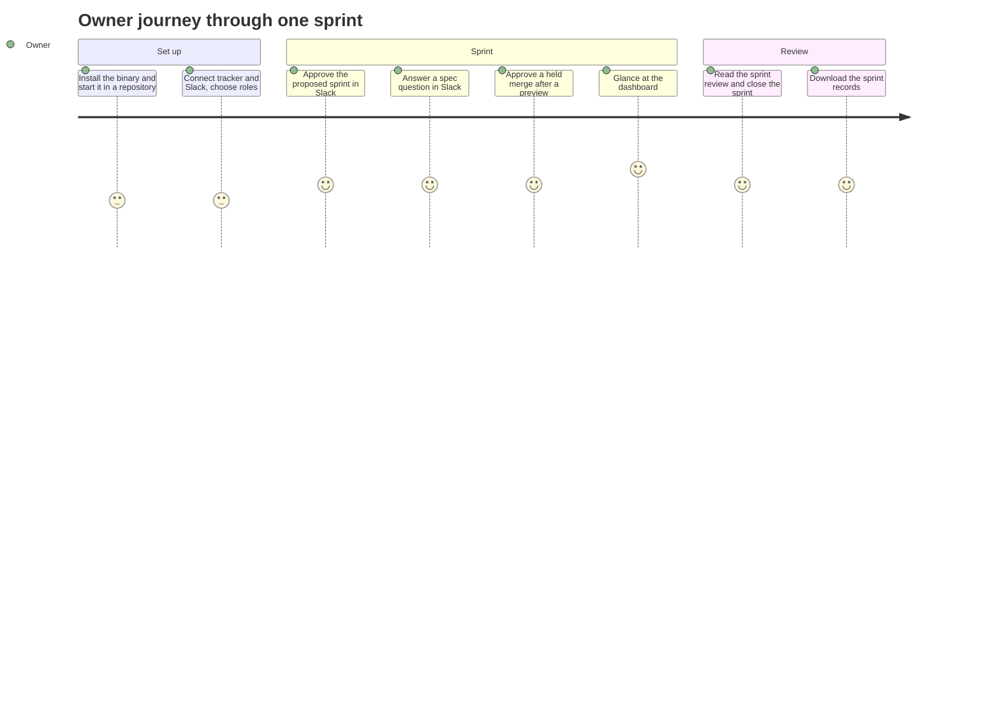
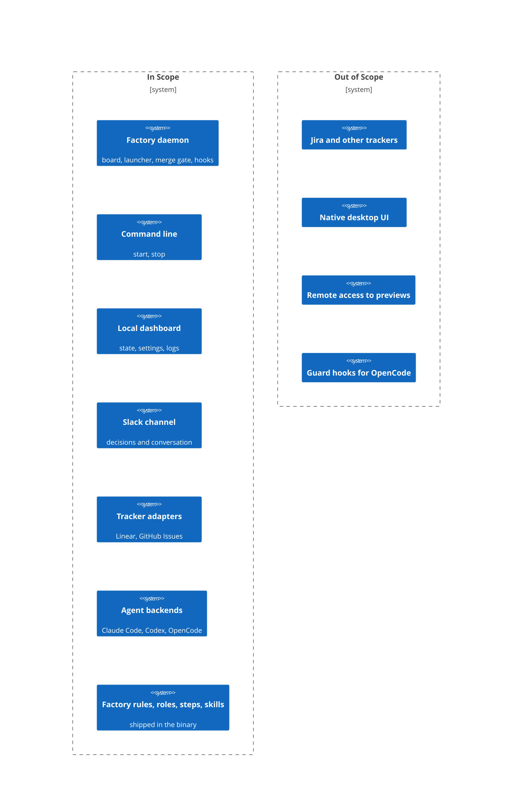

# PRD: Oven Spring

## Overview

### One-line Summary

Oven Spring is a software factory: a single binary that takes the issues a team writes in its tracker through requirements, design, implementation, review, CI and merge with coding agents, while the owner decides only what only a person can decide, through Slack.

### Background

Coding agents can now carry an issue from its requester's words to a merged pull request, but most setups keep a person in every loop: someone writes the spec, cuts tasks, reviews each pull request and decides each merge. Each of those checks can be replaced by a mechanism that fixes the boundaries and the evidence a step owes, while the path between them is left to the agents (source: "Strict Boundaries, Free Path: How I Design a Software Factory", References).

What separates this from a pipeline that executes tickets is the product goal. The owner sets where the product is heading; with that goal in view at every step, the factory chooses the issues that move toward it, judges how far to take each one, and settles what no source decides on its own. The goal is therefore the most important thing the factory shows and the first thing every agent receives.

Oven Spring is built from that published design so that it can be brought into any repository from outside, configured per repository, and kept current as it evolves.

## User Stories

### Primary Users

- **Owner**: the person who points the factory at a repository, sets its product goal, answers the decisions only a person can make, and judges each sprint. Technical, but delegates the work and does not review code.
- **Requester**: anyone who writes issues in the tracker. Interacts with the factory only through the issues they write and, when they hold write access, through review comments on its pull requests.
- **Reviewer**: a person with write access who reviews a factory pull request on GitHub, by choice or because a branch rule requires an approval.

### User Stories

```
As an owner
I want to install one binary and enable the factory in a repository
So that I can delegate a sprint of issues without building or maintaining the factory myself
```

```
As an owner
I want every decision that is mine to reach me in Slack, and nothing else
So that the factory keeps working while I only answer what it cannot settle
```

```
As an owner
I want to see at a glance whether the factory is working, whether anything waits on me, and how far the sprint has come
So that I can trust it without following every step
```

```
As an owner
I want to choose, per role, the agent CLI, model, effort, extra skills and additional instructions
So that the factory fits my repository and my cost constraints
```

```
As a reviewer
I want my review comments on a factory pull request to be answered the way the factory answers any reviewer
So that my judgment counts and a required approval can be obtained
```

```
As an owner
I want to download what the factory did in a form an agent can read and in a form fit for audit
So that I can analyze a sprint or account for it
```

### Use Cases

1. The owner installs the binary, runs it in a repository, connects the tracker and Slack, and starts the factory. The lead proposes a sprint in Slack; the owner approves it; issues run in parallel and merge as they pass.
2. Mid-sprint, the lead finds that no source decides a product behavior. The owner receives one question in Slack, answers in the thread, and the issue continues; other issues never waited.
3. A pull request touches the database schema. The owner receives a merge request in Slack, starts a preview of the issue's worktree, checks the behavior, and approves; the factory merges the exact commit that passed.
4. The repository requires one approving review. A teammate reviews, requests changes, the factory answers each comment, pushes, asks for a re-review, and merges once approved.
5. An agent CLI reaches its usage limit. The factory pauses, tells the owner why in Slack, and resumes when the owner mentions the bot with `!resume`. The owner can also pause it from Slack when the work is not going as intended.
6. At the end of the sprint the owner receives the sprint review in Slack: key results judged and the retrospective's agreement changes. The owner replies with what they think of the result, or closes the sprint; closing lets the review's agreement and knowledge changes merge and approves nothing else, the next sprint least of all. The next sprint is proposed on its own, from what the sprint showed and what the owner said about it, and starts when the owner approves that proposal.
7. The owner downloads the sprint's records and gives them to an agent to analyze where time went.

### User Journey Diagram



### Scope Boundary Diagram



## Functional Requirements

All requirements below are `desired-future`.

### MVP Requirements

- [ ] **R1 Install and enable**
  - AC-001: Given a supported machine, when the owner installs Oven Spring, then one executable is all that is installed, and running it needs no other runtime than the agent CLIs, `git` and the tools the target repository itself needs.
  - AC-002: When the owner starts Oven Spring in a repository for the first time, then the dashboard opens on its setup; the repository gains only the factory's configuration and the files the owner chooses to commit. The factory's skills exist only in the worktrees the factory creates and never enter a commit.
  - AC-059: Once started, the owner works with the factory only through Slack and the dashboard; the terminal is used only to install, start and stop it.
  - AC-060: During setup, and whenever a prerequisite is missing (the GitHub, tracker or Slack connection), the dashboard shows what is missing and how to fix it. Agent CLIs are set up by the owner, who uses them already; one that cannot run stops the factory with the CLI's own error, as any launch failure does (AC-034).
  - AC-065: During setup the owner chooses the agent CLI every role starts on; none is chosen beforehand.
  - AC-066: Setup settles how the product runs before the factory starts: the lead finds the commands in the repository and the factory starts the product once with them; the owner keeps them, changes them (checked the same way), or records that there is nothing to run. With nothing to run, agents check with tests only and a merge request offers no preview.

- [ ] **R2 Updates**
  - AC-004: The owner updates Oven Spring by replacing the executable; from the next start, every repository runs on the new version's rules, role files, step files and skills, with nothing to change in the repositories.
  - AC-071: The dashboard shows which version of Oven Spring the repository runs. When a newer release is out, or a newer executable is installed and waits for a restart, it says so and how to move to it: the install command and the restart, or the restart alone.

- [ ] **R3 Configuration**
  - AC-007: The owner can set, for each role (lead, executor, reviewer, analyzer), the agent CLI, model and effort, and the change applies from that role's next launch.
  - AC-008: The owner can select, for each role, skills found in the repository folder that role's CLI reads (`.claude/skills` for Claude Code, `.agents/skills` for Codex, either for OpenCode), and a launch of that role loads them in addition to the factory's own skills.
  - AC-009: The owner can set, for each role, additional instructions, and a launch of that role receives them at the end of its prompt.
  - AC-010: The owner can set the base branch that issue branches start from and merge into.
  - AC-011: The owner can set who merges: `factory` (the factory merges once every condition holds) or `owner` (the factory stops when the pull request is ready to merge and the owner merges).
  - AC-012: The owner can set the tracker (Linear or GitHub Issues) and its credentials, the Slack credentials and channel, and the Slack users who are owners: the factory responds only to them and counts only their approvals.
  - AC-013: Credentials are stored outside the repository, and settings stored in the repository contain no credential.
  - AC-014: When a pull request changes the factory's configuration, working agreements, knowledge or the repository's agent instructions file, then the merge gate holds it for the owner in either merge setting.

- [ ] **R4 Sprint planning** (source: the factory loop in the design article)
  - AC-015: When no sprint is running and the product goal is set, then the lead proposes a sprint from the product goal and every open issue: one purpose, stated as the state of the product or its users it reaches, the issues it needs, their dependencies, and key results that judge that state, never the work; what each issue requires is settled in that issue's own steps. The proposal reaches the owner in Slack. A proposal with no issue starts no sprint; the owner is told what is missing, and the lead proposes again once an open issue appears.
  - AC-056: The product goal is shown in the same place on every dashboard screen after setup, whose last step sets it first, and the owner rewrites it there; the next sprint proposal uses the goal as it stands, and the running sprint continues.
  - AC-057: Every agent launch receives the product goal and the current sprint's purpose, and every message that proposes or reviews a sprint states the product goal it serves.
  - AC-016: When the owner approves a sprint proposal in Slack, then the sprint starts and its independent issues run in parallel, each on its own branch and worktree.
  - AC-017: When the owner answers a sprint proposal with anything other than approval, then the lead revises the proposal from that answer.

- [ ] **R5 Issue pipeline** (source: the design article's loop)
  - AC-018: For each issue, the lead reads the issue as its requirement, settles one observable outcome, the non-goals, and each requirement with its source, and judges its scale from repository evidence before anything is designed; when the code already delivers the outcome, the lead closes the issue with the evidence. Each scale runs the implementation workflow the factory's sources define for it: a small change goes to implementation without design documents.
  - AC-019: An issue that needs design has its design verified against the code and reviewed before code is written, and its design documents and the implementation reach the base branch in the same pull request.
  - AC-020: Each implementation task ends in an executable check whose result proves the task, and the factory commits work only after the repository's quality checks pass on it.
  - AC-021: Code review and security review run as separate launches for every issue. Each finding, from a reviewer or a bot, is judged before anything is changed: what leaving it costs against what answering it adds, preferring no change, removal or reuse; only applied findings reach the author, and a finding whose answer would change the outcome reaches the owner.
  - AC-061: When an issue holds several independently valuable outcomes, the lead writes a PRD only from what the issue says and the owner's answers to its questions, the reviewer reviews it, and the owner approves it in Slack before design starts. When a smaller issue alters behavior an existing PRD states, that PRD is updated, reviewed and approved the same way before the work goes on, so no PRD is left stating what the product no longer does.
  - AC-022: When a pull request receives review comments from a bot or from an account with write access to the repository, then each comment is judged the same way as an internal finding, except that a finding a bot itself rates optional is declined without further judgment, and each is answered in its thread with the commit that applied it or the fact that settles its decline.
  - AC-023: Comments from accounts without write access and not configured as review bots receive no response and cause no change.
  - AC-024: When the branch rules require approving reviews, then the factory waits for them without blocking other issues, asks reviewers who requested changes to review again after the factory pushes, and requests approval again when a push dismissed an earlier one.
  - AC-025: When a finding's resolution would change the issue's outcome, its non-goals, or what the owner approved, then it reaches the owner instead of being applied or declined.
  - AC-026: When the merge setting is `factory`, the factory merges only the exact commit whose required checks passed, while the branch is current with the base, every required approval is present, and every owner approval the change needs is recorded; otherwise the issue goes back to the step that can make it hold.
  - AC-027: When the merge setting is `owner`, the factory never merges; it tells the owner in Slack that the pull request is ready, and it continues the issue as merged once the owner merges it.
  - AC-028: When a pull request touches a category held for the owner (schema changes, external connections, infrastructure or CI changes, changes to contracts consumed outside the repository, and the files of AC-014), then in the `factory` setting the merge waits for the owner's approval in Slack.

- [ ] **R6 Decisions and conversation in Slack**
  - AC-029: Every decision that belongs to the owner reaches them as a Slack message they can answer in place: sprint approval, a spec question, a design that adds an external connection or changes infrastructure, CI, schema or an external contract, a prototype of a new screen, a PRD, a held merge, and the sprint review.
  - AC-030: When a decision is pending, only the work that depends on it waits.
  - AC-031: A merge request in Slack lets the owner start the issue's preview and receive its local address in the thread, and approve or hold. A prototype approval links to the prototype in the dashboard and says how far the implementation will follow it.
  - AC-032: An approval counts only when given in Slack by an owner (AC-012), and the factory records who approved what and when, with a link to the message.
  - AC-033: The owner can talk with the lead in a Slack thread about any subject, and the lead is the only agent that speaks to the owner.
  - AC-034: The owner can pause and resume the factory from Slack, and learns there why the factory paused itself.
  - AC-035: The Slack integration is one implementation of a channel interface, so another channel can replace it without changing the factory's rules, roles or steps.

- [ ] **R7 Exceptions and resilience** (source: the design article's exceptions and running sections)
  - AC-036: When a step fails, is blocked, or reaches a review or CI round limit the owner set (none by default), then it reaches the lead as an exception, and the owner hears of it only when the way out is the owner's decision.
  - AC-037: When an agent CLI fails because its provider is overloaded, the factory retries it a bounded number of times; any other failure pauses the factory and tells the owner the cause and how to resume.
  - AC-039: When the factory restarts, steps that were running run again, and an implementation step first checks whether its done condition already holds; the factory keeps track of the pull requests it opened.
  - AC-062: The factory never stops silently. When an issue or the sprint cannot go on, the lead takes it as an exception and finds the way forward; when the way out is the owner's, the owner learns what happened and what would resume it. While one issue or the sprint is stopped, every unrelated piece of work keeps going.
  - AC-063: Whatever a person does outside the factory, such as merging or closing a pull request, pushing to its branch or repairing the environment, the factory reads the current state of the repository and the pull request, and continues the normal flow from there.
  - AC-064: When the way out needs a command outside what agents may run, the lead writes a recovery procedure and the owner approves it in Slack, asks for another, or marks the problem resolved after fixing it themselves. Only the factory runs an approved procedure, exactly as the owner saw it; agents cannot reach the procedures, the decisions or the approvals.
  - AC-067: The owner can cancel an issue that has not ended, from its page on the dashboard or from any Slack message on which it waits for them (a question, a recovery, a stop). The factory stops the issue's work, closes its pull request and keeps its branch, records it canceled on the tracker, with the owner's words when they gave them on the dashboard, and the issues that depend on it reach the lead as any lost dependency does.
  - AC-068: While a decision waits on the owner, the factory reminds them once an hour, in one message listing everything that waits with where to answer. When they still do not answer, the work that needs the answer keeps waiting.
  - AC-069: The owner names kinds of change a person reviews, each described in their own words (for example, payments). The design and the code review judge which a change falls under. When the factory merges, such a change waits for the owner's approval of its commit, as a held category does; when people merge, the ready-to-merge message names each kind with its words. Neither asks to approve the design.
  - AC-070: The sprint review keeps the factory's knowledge, as it keeps the working agreements: facts about the product, its code or its environment that change how the factory acts there and that the code and documents do not show, learned from the sprint's failures, from what the owner told the factory, and from research. Each sprint it keeps, rewrites or drops each file by what the sprint showed of it (whether the work there read it, whether it held, whether what it describes still exists) and by the owner's reply to the review, and adds only what later work needs. Every launch reads the knowledge that bears on a choice before making it. Its changes reach the base branch through the same pull request as the working agreements, each in the folder the owner set to fit the repository's layout (`.ovenspring/knowledge` and `.ovenspring/agreements` when none is set), and the next sprint is proposed once it merges.

- [ ] **R8 Sprint review and retrospective** (source: the design article)
  - AC-041: When every issue of the sprint has merged, been held for the owner, or been dropped, then the analyzer collects the facts, the lead judges each key result, and reviews the working agreements; the owner receives it as one review in Slack. The owner replies or closes the sprint: a reply about how the factory works revises the review's agreement changes, a reply about what to build next reaches the next sprint's proposal, and closing ends the sprint; the next sprint starts as AC-015 describes.
  - AC-042: When the owner closes the sprint, then the changed working agreements reach the base branch before the next sprint starts.

- [ ] **R9 Dashboard**
  - AC-043: When the owner opens the dashboard, the first screen shows the product goal, states whether the factory is working or paused (with the cause) and whether anything waits on the owner, shows how far the current sprint has come, and lists the sprint's issues with one state each.
  - AC-044: From an issue, the owner can see its outcome and non-goals, its progress, its review findings and how each was answered, links to its pull request and tracker issue, and its launches and cost.
  - AC-045: The owner can list the factory's launches filtered by sprint and issue, and open each one's model, duration, cost and log.
  - AC-046: The owner can download a sprint's or an issue's records in one form that an agent can read and that serves as an audit trail: launches, state changes, approvals with the approving Slack user, commits and merges.
  - AC-047: Every downloaded format masks the credentials the factory holds and values in common token formats.
  - AC-048: The dashboard offers light, dark, and system themes, and every text and control meets WCAG 2.2 AA in both themes.
  - AC-049: Owner decisions are not made in the dashboard; where a decision is pending, the dashboard links to it in Slack. Rewriting the product goal (AC-056), canceling an issue (AC-067) and changing settings are not such decisions.
  - AC-050: Every text in the product, the dashboard and the factory's own Slack messages, is in English.

- [ ] **R10 Agent backends**
  - AC-051: Each role can run on Claude Code, Codex or OpenCode, and the factory's rules, role files and step files are the same whichever runs it.
  - AC-052: Every launch runs project-scoped: the user-level skills and MCP servers of the CLI, its plugins on Claude Code and Codex, and connectors that act in the user's name, are not available to it, apart from those the configuration selects: the MCP servers the owner allows (such as a browser for web work) reach every launch on every CLI, while connectors, image generation, computer use, browser use on the user's desktop and the user's own browser stay unavailable.
  - AC-053: When the owner selects OpenCode for a role, OpenCode's own permissions stop the same commands the guard hooks stop on the other CLIs (the guard's and the owner's denied ones), written in the form its installed version reads; the guide, not the dashboard, explains this difference.
  - AC-058: Every launch runs in its CLI's auto mode by default; the owner can set the factory to bypass the CLI's permission checks at their own responsibility, and the dashboard warns what that removes.

- [ ] **R11 Guard boundaries** (source: the design article's deterministic boundaries)
  - AC-054: On Claude Code and Codex, an agent the factory launched is stopped by a hook when it tries to commit, push, merge, record an approval, reach the factory's protected files, or run a command the owner denied, such as one touching production (the factory commits and pushes itself); people's own sessions in the same repository are unaffected. Where a CLI does not run hooks in bypass mode, the warning shown when the owner selects bypass says so.
  - AC-055: The dashboard is reachable only from the machine it runs on, and another site's page open in the owner's browser can neither read nor change it.

### Future / Out of Scope

| Capability | Disposition | Reason |
|---|---|---|
| Jira and other trackers | future | Linear is required and GitHub Issues is enough as the second; Jira fits poorly. |
| Guard hooks for OpenCode | out-of-scope | OpenCode runs no hooks; its own permissions deny the same commands instead, and the guide explains the difference (AC-053). |
| Keeping the owner's OpenCode plugins out of launches | out-of-scope | OpenCode has no switch for them, and moving its configuration directory would move git's and gh's as well; the plugins are ones the owner installed, and the guide says they load. |
| A merge setting between `factory` and `owner` | out-of-scope | Branch rules already express required approvals; a third setting adds nothing. |
| Replaceable connectors other than the Slack channel | future | Only the Slack interaction sits behind an interface for now. |
| Native desktop UI | out-of-scope | The dashboard stays a web UI embedded in the binary. |
| Making owner decisions in the dashboard | out-of-scope | Decisions are made in Slack; the dashboard shows state, settings and logs. |
| Reaching a preview from another machine | out-of-scope | A preview's address is local to the factory's machine; remote access needs a tunnel the owner sets up outside the product. |
| Windows as a host | out-of-scope | The guard hooks, worktree processes and agent CLIs are targeted at macOS and Linux first. |
| Repositories with rules on the text the factory writes (commit messages, pull request titles and bodies) | out-of-scope | The factory writes these itself in fixed forms; supporting such rules spreads the authorship over every committing step. A refused commit or a failed check stops the issue and reaches the owner with a recovery procedure (AC-062 to AC-064). |

## Non-Functional Requirements

### Performance

- The dashboard reflects a change in the factory's state within one poll interval of the daemon (selected: the requirements leave it unset; a glance must not show stale state for longer than the factory's own reaction time).
- Factory overhead is negligible next to agent launches; no throughput target is set.

### Reliability

- No work is lost across a restart of the daemon or the machine (AC-039).
- A wrong merge cannot be taken back, so the merge gate is deterministic and acts only on the exact commit whose checks passed (AC-026).

### Security

- Credentials never enter the repository, logs, downloads, or prompts (AC-013, AC-047).
- Approvals carry the identity Slack asserts for the approver (AC-032).
- What the factory trusts and runs (decisions, approvals, recovery procedures) is kept where agents' launches are not given access, and the launch hook denies any agent action that names it (AC-064).
- External input that can steer an agent, such as issue text and review comments, is accepted only from the sources the factory trusts for it (AC-022, AC-023).
- The dashboard is local and answers only requests addressed to this machine (AC-055).
- Production credentials are kept away from the factory's machine; hooks catch honest mistakes and are not the boundary against production (source: the design article).

### Scalability

- Issues run in parallel up to the limits the owner configures, each with its own worktree, port and local data.

### Accessibility

- Compliance standard: WCAG 2.2 Level AA (source: the owner).
- Target assistive technologies: keyboard operation and screen readers.
- Known constraints: none.

### Neutrality

- The product, its documentation and its examples name no organization, product or project other than the tools it integrates with; examples use fictional names.

## Success Criteria

### Quantitative Metrics

None sourced for v0.1.0.

### Qualitative Metrics

1. The owner runs complete sprints on several repositories with real issues and judges the result fit to release as v0.1.0.
2. During those sprints, decisions reach the owner only when they are the owner's to make, and the owner does not need to read code to approve merges.

### UI Quality Metrics

1. An accessibility check of every dashboard screen in both themes reports no WCAG 2.2 AA failure.

## Technical Considerations

### Dependencies

- Agent CLIs: Claude Code, Codex, OpenCode (whichever the configuration uses).
- `git` and GitHub (repository hosting, pull requests, branch rules, CI status).
- Tracker: Linear or GitHub Issues.
- Slack workspace with an app the owner installs.

### Constraints

- The checks the base branch requires are the repository's standard for merging; the factory adds none of its own.
- By default agents run in each CLI's auto mode, within the permissions the organization already allows an agent; skipping a CLI's permission checks is the owner's explicit choice for every launch (AC-058).

### Assumptions

- The agent CLIs keep a non-interactive mode with machine-readable output and a hook or equivalent for Claude Code and Codex.
- Slack Socket Mode remains available, so the factory needs no public endpoint.
- Linear's and GitHub's APIs expose issue dependencies (Linear relations; GitHub `dependencies/blocked_by`).

### Risks and Mitigation

| Risk | Impact | Probability | Mitigation |
|------|--------|-------------|------------|
| A wrong merge reaches the base branch | High | Low | Deterministic gate on the exact commit; held categories; owner merge setting |
| Prompt injection through issues or review comments | High | Medium | Respond only to write-access accounts and configured bots (AC-023); guard hooks; no production credentials on the machine |
| Agent CLI changes break launching or output parsing | Medium | Medium | One backend adapter per CLI; failure classification falls back to pausing with the log |

## Undetermined Items

None.

## Appendix

### References

- Strict Boundaries, Free Path: How I Design a Software Factory — https://www.norsica.jp/blog/how-i-design-a-software-factory.md
- When Better Models Make Old Agent Workflows Worse — https://www.norsica.jp/blog/when-better-models-make-old-agent-workflows-worse.md
- Dashboard prototype — `docs/ui-spec/assets/dashboard/`

### Glossary

- **Factory**: the daemon and agents that take issues from the tracker to merged pull requests.
- **Owner**: the person who runs the factory for a repository and holds its decisions.
- **Product goal**: where the product is heading, in a short text the owner rewrites as circumstances change; every sprint serves it.
- **Sprint**: one purpose, the issues it needs, and the key results that show it reached; judged by the owner at its end.
- **Lead / executor / reviewer / analyzer**: the four roles that do the factory's work.
- **Merge gate**: the deterministic check that merges a pull request or holds it.
- **Held category**: a kind of change the owner must approve before the factory merges it.
- **Working agreements**: what the team learned about its own work, reviewed at every retrospective.
